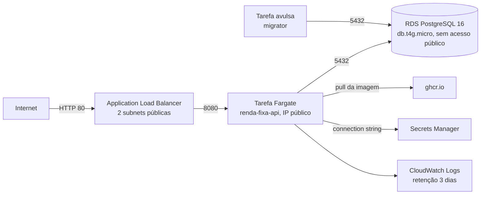

# Controle de Investimentos em Renda Fixa

 

API em .NET 8 para consolidação de carteira de renda fixa, com cálculo de rentabilidade
líquida de imposto de renda.

## O problema

Investidor pessoa física com títulos em mais de uma corretora não tem visão consolidada
da carteira. Cada instituição mostra apenas os próprios papéis, e o cálculo de
rentabilidade líquida — que depende de prazo, indexador e tributação — fica por conta do
investidor.

Esta API centraliza o cadastro dos títulos, registra os aportes e projeta a posição para
uma data de referência, já descontado o imposto devido.

## Escopo

A API cobre o cadastro de títulos, o registro de aportes, a projeção de uma posição para
uma data, a consolidação da carteira e a consulta das cotações de CDI e IPCA importadas do
Banco Central. Dez endpoints, documentados no Swagger.

`GET /health` é um health check de liveness, à parte dessa contagem. Responde 200 com o texto
`Healthy` enquanto o processo está de pé e não consulta o banco: o 200 ali não garante conexão
com o PostgreSQL. Quem prova a conexão é `GET /api/assets`.

Uma ausência é deliberada:

**Sem remoção de aporte.** Registro de aporte é histórico financeiro, e histórico se
corrige por estorno, não por exclusão. Um endpoint de estorno seria a evolução natural;
um `DELETE` não é.

A especificação funcional completa está em [`docs/ESPECIFICACAO.md`](docs/ESPECIFICACAO.md),
e as especificações de cada fase de implementação estão na mesma pasta.

## Regras de negócio

O domínio implementa as regras de cálculo abaixo, todas cobertas por teste:

**Rentabilidade pré-fixada** — capitalização composta sobre dias úteis, base 252, entre a
data de aporte e a data de referência. Os prazos de IR e de IOF continuam em dias corridos.
Os indexadores pós-fixados e o IPCA+ têm regras próprias, descritas em
[Indexadores e cotações](#indexadores-e-cotações).

**Limite de vencimento** — data de referência posterior ao vencimento é truncada para a
data de vencimento.

**Tabela regressiva de IR** — alíquota conforme o prazo decorrido: 22,5% até 180 dias,
20% até 360, 17,5% até 720 e 15% acima disso. O imposto incide exclusivamente sobre o
rendimento, nunca sobre o principal.

**Isenção** — LCI e LCA não sofrem incidência de IR para pessoa física, independentemente
do prazo.

**IOF regressivo** — incide sobre o rendimento de resgates com menos de 30 dias, antes do
IR. LCA é isenta de IOF. Detalhes na seção de indexadores.

**Vigência do aporte** — aporte com data anterior à emissão ou posterior ao vencimento do
título é rejeitado.

**Coerência do consolidado** — os totais da carteira somam os valores já arredondados de
cada projeção individual, em vez de arredondar a soma dos valores brutos. A diferença é de
centavos, mas o total precisa fechar exatamente com a lista que o usuário vê; um
consolidado que não bate com as parcelas é lido como erro do sistema.

**Alteração de título com aportes** — um título que já possui aportes não pode ter as datas
de emissão ou vencimento alteradas. Permitir isso tornaria retroativamente inválido um
aporte que era válido no momento do registro. Nome, emissor e taxa seguem alteráveis.

## Indexadores e cotações

As cotações vêm da API SGS do Banco Central: a série 12 (CDI, em % ao dia) e a série 433
(IPCA, em % no mês). Um job em segundo plano importa as duas séries ao iniciar a API e depois
a cada 6 horas. As séries publicam no máximo uma vez por dia, então a repetição existe para
recuperar falhas temporárias do provedor sem intervenção manual.

A importação é controlada por `IndexRatesImport:Enabled` no `appsettings.json` (em variável de
ambiente, `IndexRatesImport__Enabled`). Ela fica
ligada por padrão; nos testes da API fica desligada, para nenhum teste depender da internet.

### Dias úteis

Dia útil é de segunda a sexta, exceto feriados nacionais da ANBIMA, cadastrados de 2020 a
2050. A base é de 252 dias úteis por ano. Na contagem entre duas datas, a inicial entra e a
final fica de fora: aplicação numa sexta com referência na segunda seguinte conta um dia
útil. Uma data fora do calendário cadastrado gera erro, nunca uma suposição.

### Pós-fixado em CDI

`Rate` é o percentual do CDI: 100 significa 100% do CDI. Para cada dia útil do período, o
fator diário é `1 + CDI do dia × Rate / 100`, com o CDI em fração (série 12 dividida por 100).

As casas decimais seguem a metodologia de DI da B3. A taxa diária tem 8 casas, sem
arredondamento. O acumulado é truncado em 16 casas a cada dia, e o fator final é arredondado
em 8 casas antes de multiplicar pelo principal.

Se faltar cotação de algum dia útil do período, a projeção não é calculada, e a resposta
informa a primeira data sem cotação. Não há valor padrão nem estimativa.

### IPCA+

O valor bruto é `principal × fator IPCA × (1 + Rate / 100) ^ (DU / 252)`, em que `Rate` é a
taxa real anual e DU é o número de dias úteis do período.

O fator IPCA é o produto de `(1 + IPCA do mês / 100)` de cada mês civil do período. Um mês
inteiro entra com a variação completa. Um mês parcial entra elevado à fração de dias úteis
do período sobre o total de dias úteis do mês civil.

Um mês cujo IPCA ainda não foi divulgado usa a última variação publicada. Nesse caso a
projeção sai com `isEstimated: true`. Quando o IPCA oficial é importado, as projeções
passam a usá-lo, sem nenhuma alteração no cadastro.

**Simplificações do IPCA.** A convenção de mercado usa a data de aniversário do título e
defasagem de um mês no índice, como fazem CDB e NTN-B. Aqui o período é o mês civil, sem
defasagem, então a projeção pode diferir da que o banco informa. Além disso, o fator é o
produto das variações mensais publicadas com duas casas decimais. A B3 usa a razão entre
números-índice, e o resultado difere um pouco dessa razão.

### IOF e IR

O IOF regressivo incide sobre o rendimento de resgates com 1 a 29 dias corridos, pela tabela
do anexo do Decreto 6.306/2007. A partir de 30 dias, a alíquota é zero. O IOF é apurado antes
do IR, e o IR incide sobre o rendimento menos o IOF.

LCA é isenta de IOF (Decreto 6.306/2007, art. 32, § 2º, V). LCI, CDB e Tesouro Direto pagam
IOF normalmente.

Quando o rendimento é menor ou igual a zero, IOF e IR são zero. A alíquota continua a ser a
da tabela para o prazo, e apenas o valor é zerado.

### Arredondamento

Cada projeção arredonda nesta ordem: valor bruto, IOF e IR, com o rendimento sendo a
diferença entre o bruto arredondado e o investido. O líquido é a subtração dos valores já
arredondados, o que faz cada projeção fechar exatamente: `bruto − IOF − IR = líquido`.

### Exemplo de chamada

As cotações são consultadas por indexador e período, com `from` e `to` obrigatórios no
formato `yyyy-MM-dd`. O período é fechado nos dois lados.

```
GET /api/indexes/Cdi?from=2026-09-14&to=2026-09-15
```

Resposta, com status 200:

```json
{
  "statusCode": 200,
  "success": true,
  "message": null,
  "data": [
    { "indexType": "Cdi", "referenceDate": "2026-09-14", "value": 0.051660 },
    { "indexType": "Cdi", "referenceDate": "2026-09-15", "value": 0.051660 }
  ]
}
```

Para IPCA, a data de referência é sempre o dia 1 do mês. Por isso o filtro compara com o
dia 1: `from=2026-01-15` não inclui janeiro. Um período sem cotações devolve 200 com a lista
vazia. Data inicial posterior à final, PreFixed e indexador inexistente devolvem 400. O indexador
vai pelo nome, sem diferenciar maiúsculas; o número do enum (`/api/indexes/1`) também devolve 400.

### Projeção e resumo da carteira

A projeção diz qual data de referência foi usada e a data do aporte. O exemplo é um CDB
prefixado a 10% a.a., R$ 1.000 aplicados em 2025-04-01 e projetados em 2025-04-22. Alíquotas em
pontos percentuais.

```
GET /api/positions/{id}/projection?referenceDate=2025-04-22
```

```json
{
  "statusCode": 200,
  "success": true,
  "message": null,
  "data": {
    "positionId": "7c1f0e52-3a4b-4e0d-9b8a-2d5c6f1a9e01",
    "assetId": "b3d2a6f4-81c7-4a52-8f3e-0c9d7e4b5a12",
    "investedAmount": 1000,
    "grossAmount": 1004.93,
    "grossYield": 4.93,
    "taxRate": 22.5,
    "taxAmount": 0.78,
    "netAmount": 1002.67,
    "elapsedDays": 21,
    "businessDays": 13,
    "iofRate": 30,
    "iofAmount": 1.48,
    "isEstimated": false,
    "referenceDate": "2025-04-22",
    "applicationDate": "2025-04-01"
  }
}
```

`referenceDate` é a data pedida: a informada ou, se omitida, a padrão (o dia útil seguinte à
última cotação de CDI importada). Numa posição vencida ela continua sendo a data pedida, mas os
valores são os do vencimento; quem exibe compara com o `maturityDate` do título.

O resumo traz `referenceDate` na raiz, sempre presente, e `positions`, as posições incluídas no
resumo, da mais recente para a mais antiga. Cada item tem a `projection` (o mesmo formato acima)
e o `asset` (o mesmo formato de `/api/assets`). Os totais são a soma exata dos itens. O exemplo
é a chamada sem `referenceDate`, com duas posições (um CDB e uma LCI aportada em 2025-05-05,
depois da data padrão 2025-04-22); os trechos `…` foram omitidos aqui por brevidade.

```
GET /api/portfolio/summary
```

```json
{
  "statusCode": 200,
  "success": true,
  "message": null,
  "data": {
    "totalInvestedAmount": 1500,
    "totalGrossAmount": 1504.93,
    "totalGrossYield": 4.93,
    "totalTaxAmount": 0.78,
    "totalIofAmount": 1.48,
    "totalNetAmount": 1502.67,
    "positionCount": 2,
    "byAssetType": [ … ],
    "referenceDate": "2025-04-22",
    "positions": [
      {
        "projection": { "positionId": "…", "assetId": "…", "investedAmount": 500, "…": "…",
                        "referenceDate": "2025-05-05", "applicationDate": "2025-05-05" },
        "asset": { "id": "…", "name": "LCI Banco Y", "issuer": "Banco Y", "assetType": "Lci",
                   "indexType": "Cdi", "rate": 100, "issueDate": "…", "maturityDate": "…" }
      },
      {
        "projection": { "positionId": "…", "…": "…", "referenceDate": "2025-04-22",
                        "applicationDate": "2025-04-01" },
        "asset": { "…": "…" }
      }
    ]
  }
}
```

A `referenceDate` da raiz é a data do resumo. A da `projection` de cada item é igual a ela,
exceto na posição aportada depois da data padrão, que é projetada na própria data do aporte
(rendimento zero), como a LCI acima. Para abrir a projeção de um item, passe a
`projection.referenceDate` dele. Com `referenceDate` informada, a posição aportada depois dela
não entra no resumo nem em `positions`. Os totais incluem valores estimados quando algum item
tem `isEstimated: true`.

## Arquitetura

```
src/
  FixedIncome.Domain          entidades, invariantes, regras de cálculo
  FixedIncome.Application     casos de uso, DTOs, interfaces de repositório
  FixedIncome.Infrastructure  EF Core, configurações de entidade, repositórios
  FixedIncome.Api             controllers, middleware, injeção de dependência
tests/
  FixedIncome.Domain.Tests
  FixedIncome.Application.Tests
  FixedIncome.Infrastructure.Tests
  FixedIncome.Api.Tests
  FixedIncome.Architecture.Tests
```

Dependências apontam para dentro: `Api → Application → Domain`, com `Infrastructure`
implementando as interfaces declaradas em `Application`. O projeto `Domain` não tem
nenhuma referência de projeto nem de pacote de infraestrutura. Essas regras de camada são
testes automatizados, descritos na seção [Qualidade](#qualidade): uma violação quebra o build.

## Decisões técnicas

**Cálculo no domínio, não no caso de uso.** Rentabilidade e apuração de IR são regras que
independem de orquestração e precisam ser testáveis sem infraestrutura. Ficam na entidade
`Position` e na tabela `IncomeTaxTable`.

**Entidades que não existem em estado inválido.** Invariantes são validadas no construtor,
com setters privados e `DomainException` em caso de violação. O custo é um construtor
privado adicional para materialização pelo EF Core; o ganho é que nenhuma camada acima
precisa reconfirmar o que o domínio já garantiu.

**`decimal` em todo o cálculo monetário.** Representa valores de base 10 com exatidão,
diferente de `double`. A única exceção é a exponenciação da capitalização composta, já que
`Math.Pow` não tem sobrecarga para `decimal` — a conversão é isolada nessa operação e o
resultado é arredondado a centavos em seguida.

**Arredondamento apenas na saída.** Todo o cálculo intermediário permanece sem
arredondamento; só os valores do `PositionProjection` são arredondados, com
`MidpointRounding.AwayFromZero`.

**Enums persistidos como texto, não como inteiro.** Valor legível diretamente no banco e
imune a reordenação futura do enum — persistir o índice significa que inserir um novo valor
no meio da declaração reinterpreta silenciosamente os dados já gravados.

**Encapsulamento preservado no mapeamento.** `Id` não tem setter público, então o EF Core
não consegue materializá-lo pela propriedade. A saída foi `PropertyAccessMode.Field` na
configuração, e não afrouxar o domínio para acomodar o ORM. O mesmo princípio vale para o
relacionamento: `Position` guarda apenas `AssetId`, sem propriedade de navegação, e a
configuração declara a chave estrangeira sem introduzir uma.

**Exclusão restrita, não em cascata.** A chave estrangeira usa `Restrict`. Remover um
título que possui aportes deve falhar de forma explícita, não apagar o histórico do
investidor em silêncio.

**Cada camada registra as próprias dependências.** `AddApplication` vive em Application e
`AddInfrastructure` em Infrastructure; a API apenas compõe. O ponto de entrada não precisa
conhecer o interior de nenhuma camada para montá-las.

**Migration aplicada manualmente, não na inicialização.** Chamar `Database.Migrate()` no
startup é conveniente e comum, mas com múltiplas instâncias duas podem migrar ao mesmo
tempo, e uma falha de migration impede a aplicação de subir. O comando está documentado
abaixo e é executado uma vez.

**Consulta ao banco fora do domínio, decisão dentro.** A regra de alteração de título com
aportes precisa saber se existem aportes — informação que só o banco tem. A entidade recebe
isso como parâmetro (`hasPositions`) em vez de consultar um repositório: o dado vem de fora,
a decisão permanece no domínio.

**Middleware de exceção como rede de segurança.** Os casos de uso já convertem
`DomainException` em resposta 400, porque são eles que sabem qual regra foi violada. O
middleware existe para o que escapar, não para substituir esse tratamento.

**Erros de validação usam o mesmo envelope dos demais.** Por padrão, o `[ApiController]`
responde com `ProblemDetails` quando rejeita a requisição antes do controller — campo
ausente, GUID malformado, data inválida. Isso quebraria o contrato justamente no erro mais
comum de qualquer integração, então a fábrica de resposta de validação foi substituída. O mesmo vale
para 404 de rota inexistente, 405 e 415, que o framework devolve sem corpo ou como `ProblemDetails`:
são reescritos no envelope por `UseStatusCodePages`, só quando a resposta está vazia.

**Sem biblioteca de mock nos testes.** Dublês, quando necessários, são classes
`private sealed` declaradas no próprio arquivo de teste. Testes de domínio não precisam de
nenhum, já que as entidades não têm dependência externa.

## Como executar

### Com Docker, sem instalar nada

Requer apenas Docker.

```bash
git clone https://github.com/matheuscardosolazzarini/renda-fixa-api.git
cd renda-fixa-api
docker compose up --build -d
```

Sobe a API e o PostgreSQL. Aplique a migration uma vez. A imagem da API só tem o runtime, sem
o SDK, então o `dotnet ef` roda num contêiner do SDK que compartilha a rede do contêiner do
banco (`fixedincome-db`), onde o PostgreSQL responde em `localhost:5432`, a mesma conexão que o
`appsettings.Development.json` já usa:

```bash
docker run --rm --network container:fixedincome-db -v "${PWD}:/src" -w /src \
  mcr.microsoft.com/dotnet/sdk:8.0 \
  sh -c 'dotnet tool restore && dotnet ef database update --project src/FixedIncome.Infrastructure --startup-project src/FixedIncome.Api'
```

Execute-o na raiz do repositório, num terminal bash ou PowerShell (no cmd do Windows, troque
`${PWD}` pelo caminho da pasta). Em PowerShell, escreva o comando numa só linha. A primeira
execução baixa a imagem do SDK e os pacotes, e leva alguns minutos.

Depois da migration, reinicie a API:

```bash
docker compose restart api
```

A API importa as cotações de CDI e IPCA ao subir, antes de a migration existir, e a importação
falha por falta da tabela. O próximo ciclo só ocorreria 6 horas depois; sem o reinício, a
projeção de CDI e de IPCA+ falha até lá.

O Swagger fica em `http://localhost:8080/swagger`.

### Localmente, com o SDK

Requer .NET 8 SDK e Docker. O `global.json` fixa o SDK 8.0 (aceita 8.0.100 ou um 8.0.x mais novo):
com só o SDK 9 ou 10 instalado, o `dotnet` recusa o projeto em vez de compilar com outra versão.

```bash
docker compose up -d db
dotnet tool restore
dotnet ef database update --project src/FixedIncome.Infrastructure --startup-project src/FixedIncome.Api
dotnet run --project src/FixedIncome.Api
```

O `dotnet tool restore` não é opcional: o `dotnet-ef` está fixado como ferramenta local em
`.config/dotnet-tools.json`, para que a versão usada aqui e no CI seja a mesma.

**Variável de ambiente que sobra no terminal.** Se `ConnectionStrings__DefaultConnection` estiver
definida no terminal, ela tem precedência sobre o `appsettings.Development.json` no `dotnet ef`, no
`dotnet run` e no bundle. Uma variável esquecida de uma sessão anterior faz o `dotnet ef database
update` migrar outro banco sem nenhum aviso. Para conferir sem imprimir a senha e para limpar:

```bash
[ -n "$ConnectionStrings__DefaultConnection" ] && echo definida || echo "não definida"
unset ConnectionStrings__DefaultConnection
```

```powershell
Test-Path Env:ConnectionStrings__DefaultConnection
Remove-Item Env:ConnectionStrings__DefaultConnection
```

Variável vazia ou só com espaços é ignorada pela fábrica do `dotnet ef`, que volta ao arquivo.
A opção `--connection` do `dotnet ef` vence o arquivo.

O arquivo `src/FixedIncome.Api/FixedIncome.Api.http` traz requisições de exemplo na ordem
de um fluxo real: criar título, listar, registrar aporte, projetar, consolidar. No fim,
consultam-se as cotações de CDI e IPCA e são feitas projeções de um CDB em CDI e de um CDB
IPCA+. A variável de base no topo do arquivo aponta para a porta 5124, a do `dotnet run`; para
a API em Docker (Compose ou imagem publicada, porta 8080), troque o número na primeira linha.

As cotações de CDI e IPCA são importadas do Banco Central ao iniciar a API e a cada 6 horas.
Para desligar a importação, defina `IndexRatesImport:Enabled` como `false` (em variável de
ambiente, `IndexRatesImport__Enabled=false`). Sem cotações importadas, a projeção de CDI e de
IPCA+ falha; a de PreFixed não depende delas.

A migration não é aplicada na inicialização — a decisão está registrada acima e comentada
no `Program.cs`.

### Imagem publicada

A cada merge na `main`, o workflow `release.yml` roda o CI e, com ele verde, publica a imagem
da API no GitHub Container Registry, em `ghcr.io/matheuscardosolazzarini/renda-fixa-api`. Antes
de a imagem ser promovida, o próprio workflow a testa:

1. Gera o migration bundle do EF Core e o anexa à execução como artefato `efbundle-<sha>`. O
   artefato fica disponível por 7 dias, e baixá-lo exige login no GitHub.
2. Publica a imagem com a tag do SHA do commit, `ghcr.io/matheuscardosolazzarini/renda-fixa-api:<sha>`.
   Desde a F11, publica também a imagem de migração, `:<sha>-migrator`, montada com o mesmo bundle.
3. Aplica as migrations num PostgreSQL limpo rodando a imagem `<sha>-migrator` baixada do registro,
   e sobe a imagem da API contra esse banco. A execução só passa se `/health` e `/api/assets`
   responderem 200.
4. Só depois disso move a tag `latest` para a mesma imagem, e só se o commit ainda for o topo da
   `main` naquele momento. Se a `main` já avançou (num re-run de uma execução antiga, por
   exemplo), o log traz um aviso e `latest` não se move.

Logo, `latest` é a versão aprovada pelo smoke test. A tag do SHA é a candidata: se o smoke
falhar, ela continua no registro, mas `latest` segue apontando para a versão anterior.

O workflow também pode ser disparado à mão (`workflow_dispatch`, pela aba Actions do GitHub), com a
mesma trava do `latest`: só move a tag a partir da `main` e com o commit ainda no topo. Push que só
altera arquivos de `docs/` ou `.md` da raiz (como este README) não dispara o release.

**Aplicando o bundle.** O download do artefato vem compactado em zip. O bundle é um executável
linux-x64, então roda em Linux ou no WSL. Ele lê a connection string pela mesma variável que a
API, `ConnectionStrings__DefaultConnection`. O `--connection` é opcional, mas a variável é
obrigatória mesmo assim, porque a fábrica do contexto a exige:

```bash
chmod +x efbundle
ConnectionStrings__DefaultConnection="Host=localhost;Port=5432;Database=fixedincome;Username=fixedincome;Password=fixedincome" ./efbundle
```

Os blocos bash desta seção são para Linux ou WSL. No PowerShell 5.1, `chmod` e `VAR=valor comando`
não existem, e o bundle não roda direto no Windows. Há dois caminhos: abrir o terminal do WSL e
usar o bloco acima, ou executar o bundle num contêiner Linux `runtime-deps`, com a pasta do
`efbundle` montada e a variável passada com `-e`, numa linha só (`host.docker.internal` é o host do
banco a partir do contêiner no Docker Desktop):

```powershell
docker run --rm -v "${PWD}:/work" -w /work -e "ConnectionStrings__DefaultConnection=Host=host.docker.internal;Port=5432;Database=fixedincome;Username=fixedincome;Password=fixedincome" mcr.microsoft.com/dotnet/runtime-deps:8.0 sh -c 'chmod +x ./efbundle && ./efbundle'
```

Para gerar o bundle a partir do código, em vez de baixar o artefato, use o mesmo comando do workflow,
com a saída na pasta atual (`--output efbundle`, em vez de `artifacts/efbundle`), depois de `dotnet tool restore`:

```bash
dotnet ef migrations bundle --project src/FixedIncome.Infrastructure --startup-project src/FixedIncome.Api --configuration Release --self-contained --target-runtime linux-x64 --output efbundle --force
```

**Migration alvo e reversão.** O bundle aceita uma migration como argumento e leva o banco até ela
(`./efbundle 20260818070004_InitialCreate`); sem argumento, aplica todas. Um nome que não existe
termina com erro (`The migration '...' was not found`). O argumento `0` reverte todas as migrations,
e o bundle não pede confirmação: `./efbundle 0` remove as tabelas da aplicação, com os dados, e
deixa só o histórico de migrations (`__EFMigrationsHistory`), vazio. Confira o banco apontado pela
connection string antes de rodar.

**Lendo um erro do bundle.** A causa vem na primeira linha da saída, e a pilha completa vem depois
(comportamento padrão do EF). Leia a primeira linha. Alguns exemplos:

- `28P01: password authentication failed`: usuário ou senha errados;
- `Name or service not known` ou `Connection refused`: host ou porta errados;
- `Host can't be null`: a connection string chegou sem host. Acontece com `--connection ""`, ou seja,
  a opção veio vazia (por exemplo, de uma variável de shell que não estava definida). Com
  `--connection` vazio o bundle não cai de volta na variável `ConnectionStrings__DefaultConnection`;
- `Connection string não encontrada`: a variável está ausente, vazia ou só com espaços. A mensagem
  cita também o `appsettings.Development.json`, que não vale para o bundle: o que resolve é definir a
  variável.

A senha não aparece na saída do bundle nem nos logs da API, nos casos exercitados no QA.

**Nome do banco.** Se o banco da connection string não existir, o bundle o cria e aplica as
migrations nele, e termina com sucesso: é o EF que cria o banco ao aplicar as migrations. Um erro
de digitação no `Database=` vira um banco novo e vazio, enquanto a API continua apontando para o
banco certo. Confira o nome do banco na connection string antes de rodar o bundle.

**Rodando a imagem publicada.** Suba o banco do Compose e aplique o bundle antes da API. Se o
serviço `api` do Compose estiver rodando, ele ocupa a porta 8080: pare-o antes com
`docker compose stop api`. A imagem publicada roda em Production, sem Swagger: o endereço
`/swagger` da seção anterior vale só para o Compose, que usa Development. Depois:

```bash
docker pull ghcr.io/matheuscardosolazzarini/renda-fixa-api:latest
docker run -d --name renda-fixa-api-ghcr -p 8080:8080 \
  -e ConnectionStrings__DefaultConnection="Host=host.docker.internal;Port=5432;Database=fixedincome;Username=fixedincome;Password=fixedincome" \
  ghcr.io/matheuscardosolazzarini/renda-fixa-api:latest
```

No PowerShell 5.1 a `\` não continua a linha: escreva o `docker run` numa linha só.

```powershell
docker run -d --name renda-fixa-api-ghcr -p 8080:8080 -e "ConnectionStrings__DefaultConnection=Host=host.docker.internal;Port=5432;Database=fixedincome;Username=fixedincome;Password=fixedincome" ghcr.io/matheuscardosolazzarini/renda-fixa-api:latest
```

`host.docker.internal` é o host do banco a partir do contêiner no Docker Desktop (Windows e
macOS). No Linux, essa ponte não existe por padrão: troque `-p 8080:8080` por `--network host` e
o host por `localhost`.

**Importação de cotações na imagem.** Com a importação ligada (padrão do `appsettings.json`), a
imagem chama a API do Banco Central ao subir. Para desligá-la, acrescente
`-e IndexRatesImport__Enabled=false` ao `docker run`. Em variável de ambiente o separador é `__`,
não `:`: `IndexRatesImport:Enabled` é a forma do `appsettings.json`. Só `true` (ou a variável
ausente) mantém a importação ligada; qualquer outro valor, como `1` ou `yes`, a desliga, e a API
registra no log da partida que a importação está desligada.

**Ordem de subida.** Aplique o bundle antes de subir a imagem. Se ela subiu antes, enquanto o
bundle não for aplicado `GET /health` continua respondendo 200, mas todo `/api/*` responde 500
(as tabelas não existem). Depois de aplicar o bundle, as rotas de `/api/*` voltam a responder 200 sem
reiniciar a API. Com a importação ligada, porém, a da partida já falhou por falta da tabela
`index_rate`, e o próximo ciclo só ocorre em 6 horas: até lá a projeção de CDI e de IPCA+ falha.
Reinicie o contêiner (`docker restart renda-fixa-api-ghcr`) para a importação rodar de novo.

**Aviso sobre o pacote.** O pacote nasce privado no GHCR. Enquanto o autor do repositório não o
tornar público nas configurações do pacote, o `docker pull` só funciona com login no GitHub
(`docker login ghcr.io`).

### Por que a nuvem estava adiada

A publicação em nuvem com Terraform esteve adiada de 08/11/2026 a 19/11/2026, quando voltou como
F11. A assinatura do Azure foi desabilitada ao fim do crédito de avaliação, e não há orçamento para reativá-la. Terraform que
nunca rodou contra um ambiente real não prova nada, e foi isso que adiou a fase. A F11 volta com um
destino: uma conta AWS no Free account plan, com ambiente efêmero e validação ao vivo (ver
[Nuvem na AWS (F11)](#nuvem-na-aws-f11)). Os dois caminhos avaliados antes dela estão descritos em
[`docs/ROADMAP.md`](docs/ROADMAP.md).

## Nuvem na AWS (F11)

A API roda na AWS num ambiente **efêmero**: sobe para uma demo, tem prazo de validade e é destruído
sozinho. Nada que cobra por hora fica ligado fora dela. O ambiente (ECS Fargate, Application Load
Balancer e RDS PostgreSQL 16, em `us-east-1`) é descrito em Terraform, em `infra/aws/`, e é
operado pelo workflow `.github/workflows/infra-aws.yml`. O detalhamento e as decisões estão em
[`docs/SPEC-F11-EXECUCAO.md`](docs/SPEC-F11-EXECUCAO.md).



**Rede e security groups.** Só rede pública, sem NAT. A cadeia é internet, ALB (80), tarefa (8080) e RDS (5432), e
cada elo só aceita o anterior. A saída também é restrita: o ALB só sai para a tarefa na 8080; a tarefa (API e
migração, mesmo SG) só sai em 443 para a internet (GHCR, Secrets Manager, CloudWatch Logs, ECS e a API do SGS
do Banco Central, todos por HTTPS) e em 5432 para o SG do RDS; o RDS não tem regra de saída. O DNS da VPC não
precisa de regra: a documentação da AWS diz que security groups não o bloqueiam. O security group padrão da VPC é
adotado sem nenhuma regra (`aws_default_security_group`), e o ALB descarta cabeçalhos HTTP inválidos
(`drop_invalid_header_fields`).

> **Aviso: a conta fica no Free account plan. Nunca faça upgrade.**
>
> A conta foi criada em "Sign up for AWS (advanced)", com o Free account plan. **Nunca faça upgrade
> para o plano pago, nunca entre no AWS Organizations e nunca crie landing zone do Control Tower nem
> IAM Identity Center em modo de organização.** Qualquer um desses faz o upgrade automático da conta,
> e a partir daí a AWS cobra.
>
> **Data de fechamento da conta:** o plano dura 6 meses ou até acabarem os créditos, o que vier
> primeiro. `(preencher no P0: data de criação + 6 meses)`
>
> Ao fechar a conta, apague a variable `AWS_ROLE_ARN` do repositório: sem ela, a guarda dos jobs
> que falam com a AWS impede qualquer execução.

### Bootstrap no CloudShell

O bootstrap roda **uma vez**, pelo Matheus, no AWS CloudShell da conta, com MFA ativo no usuário
root. O script não cria chave de acesso: o GitHub entra na AWS por OIDC. Ele é idempotente, então
pode rodar de novo para corrigir um passo que falhou ou para atualizar as policies.

```bash
git clone --depth 1 --branch main https://github.com/matheuscardosolazzarini/renda-fixa-api.git
bash renda-fixa-api/infra/aws/bootstrap/bootstrap.sh --email voce@exemplo.com
```

Até o merge da F11, use `--branch f11-nuvem-aws`. O e-mail é obrigatório (`--email`, ou a variável
`BUDGET_EMAIL`) e é validado de forma estrita, porque entra em JSON. Com `--imprimir-policy-ci`, o
script só imprime a policy da role do CI e não chama a AWS.

O bootstrap cria o que não cobra por hora e que o Terraform do ambiente não pode criar nem destruir:

- o bucket do state (`renda-fixa-api-tfstate-<conta>`), com acesso público bloqueado, SSE-S3,
  versionamento, expiração das versões antigas em 7 dias e negação de acesso sem TLS;
- o provedor OIDC do GitHub e a role `renda-fixa-gha`, com sessão de 2 h e trust só do environment
  `aws` deste repositório;
- a execution role `renda-fixa-api-execution` das tarefas ECS;
- as service-linked roles de ECS, Elastic Load Balancing e RDS, se faltarem;
- o budget `renda-fixa-api-mensal`, de US$ 5 por mês **sem créditos**, com alertas por e-mail em
  US$ 1, US$ 3 e US$ 5.

No fim, o script imprime os três identificadores que vão para o GitHub (`AWS_ROLE_ARN`, `AWS_REGION`
e `TF_STATE_BUCKET`). Ele não imprime nenhum segredo.

**Confirme a assinatura do e-mail do budget.** A AWS envia uma mensagem de inscrição para o endereço
informado. Sem aceitá-la, os alertas da camada 5 não chegam.

### Configuração no GitHub

1. **Environment `aws`** (Settings, Environments). Em *Deployment branches*, use *Selected branches*
   com **só `main`**. **Não configure required reviewers**: com aprovação obrigatória, o destroy
   agendado ficaria esperando um humano e o TTL morreria.
2. **Variables** (sem nenhum secret: a autenticação é OIDC):
   - `AWS_ROLE_ARN`: variable de **repositório**, não de environment. Decisão de 19/11/2026: o `if`
     de nível de job é avaliado antes de o job entrar no environment, então uma variable de
     environment não chega ao guard. É seguro porque o trust da role exige
     `sub = repo:matheuscardosolazzarini/renda-fixa-api:environment:aws`: só um job que entra no
     environment `aws` consegue assumir a role.
   - `AWS_REGION` (`us-east-1`) e `TF_STATE_BUCKET` (o nome impresso pelo bootstrap): variables do
     environment `aws`.
3. **Pacote do GHCR público.** A imagem `ghcr.io/matheuscardosolazzarini/renda-fixa-api` nasce
   privada. Em *Package settings*, torne-a pública. O `subir` confere as tags sem login e reprova
   se o pacote não for público.

### Como subir e destruir

Na aba Actions, rode o workflow **Infra AWS** (`workflow_dispatch`) na branch `main`:

- `acao`: `subir` ou `destruir`;
- `horas` (só para `subir`): inteiro de 1 a 12, padrão 4;
- `sha` (só para `subir`, opcional): 40 hexadecimais minúsculos. Vazio = SHA lido do rótulo
  `org.opencontainers.image.revision` da tag `latest`.

O `subir` faz, nesta ordem:

1. **Guardas:** entradas válidas; último commit da `main` com menos de 45 dias; resolve o SHA; confere
   sem login que as tags `<sha>` e `<sha>-migrator` existem no GHCR.
2. Calcula dois prazos: o definitivo (`expires_at`, agora + `horas`) e um **provisório** de 1 h (ou o
   definitivo, se for menor). Faz `plan`, a trava de custo, a checagem de recriação e o `apply` com
   `service_desired_count = 0` e o prazo provisório: rede, banco, secret, ALB, cluster e as duas task
   definitions, sem nenhuma tarefa da API. O prazo provisório existe para o caso de o `subir` e o
   `limpar` falharem: o ambiente meio montado não fica válido até o TTL inteiro, e o agendado o
   destrói em até cerca de 1 h 30 min (1 h do prazo provisório, mais até 30 min até o próximo agendado,
   mais a duração do ciclo).
3. **Migração:** roda uma tarefa avulsa da família `renda-fixa-migrator`. Exige `exitCode 0`, e a
   tarefa é parada ao fim, mesmo com falha.
4. `plan`, trava de custo, checagem de recriação e `apply` com `service_desired_count = 1` e o prazo
   **definitivo**: sobe a API. Trocar o prazo entre as fases é só um update no lugar da tag
   `expires_at` do cluster e do output; nada é recriado.
5. Espera o serviço estável e o alvo do ALB `healthy` (prazo de 15 min).
6. Smoke no DNS do ALB: `/health` e `/api/assets` precisam responder 200.
7. `plan -detailed-exitcode`: precisa sair sem diferença.
8. Resumo do job com o DNS do ALB, o SHA e o `expires_at`.

A ordem é obrigatória. Se a API subisse antes das migrations, a importação de índices da partida
falharia por falta da tabela `index_rate` e só tentaria de novo em 6 horas.

**Recriação do banco ou do secret.** A senha do banco nasce a cada execução e entra no RDS e no secret
uma única vez. Se um `plan` do `subir` (prorrogar um ambiente existente, por exemplo) trouxer a
**substituição** do RDS ou da versão do secret, o passo "Bloquear recriação" reprova antes do `apply`:
com o banco novo e o secret antigo, a API subiria com a senha errada. A mensagem lista o recurso e
manda rodar `destruir` e depois `subir` de novo. O `limpar` já destrói o ambiente depois dessa falha.

**Prorrogar** é rodar `subir` de novo antes do vencimento. Como a primeira fase zera as tarefas, a API
reinicia (e a importação do BC roda de novo). Passe o mesmo `sha` se quiser manter a imagem: sem ele,
o `subir` usa a `latest`, que pode ser outra versão.

**Destruir** (`acao = destruir`) lê `expires_at` e `image_sha` do state, para tarefas de migração,
destrói o ambiente e confere a conta. Termina vermelho se sobrar qualquer recurso. O passo que para as
tarefas de migração tem `continue-on-error`: se ele falhar (rede, região), o `destroy` roda mesmo assim,
e o `destroy` e a verificação de zerado continuam decidindo a cor do job. O `limpar` e o agendado fazem o
mesmo.

**O primeiro `subir` exige um merge na `main`** com o `release.yml` desta fase: as imagens publicadas
antes dela não têm a tag `-migrator`, e a guarda reprova o `subir` antes de criar qualquer coisa.

**O agendado** roda a cada 30 min (minutos 7 e 37). Se há uma execução manual do workflow em andamento
ou na fila, ele termina com aviso e deixa para o próximo ciclo. Sem ambiente no state, só confere a
conta. Com ambiente vencido, ou com `expires_at` ausente ou inválido, destrói e confere. Dentro do
prazo, termina verde e mostra o tempo restante.

O destroy do agendado não pode derrubar um ambiente que um `subir` esteja prorrogando, então ele não é um
`terraform destroy` direto (`infra/aws/scripts/destruir-se-vencido.sh`). Ele faz `plan -destroy` com o plano
salvo e lê o prazo da **tag `expires_at` do cluster** no state desse mesmo plano (não do output `expires_at`:
num `plan -destroy` o Terraform recalcula os outputs com as variáveis da chamada, então o output só repete o
valor já lido). Só segue se a tag continuar vencida, ausente, inválida ou acima do limite de 12 h da `validation` do
Terraform (mais 10 min de folga: uma tag assim só pode ter sido editada fora do Terraform, e nunca prorroga). Depois confere a fila manual de novo
logo antes de aplicar e aplica o plano salvo. Assim, um `subir` que prorrogue o ambiente antes do plano é visto
pela tag, e um que grave o state depois do plano faz o Terraform recusar o plano (`Saved plan is stale`) e
nada é destruído. A verificação de zerado só roda depois de um destroy aplicado.

**O `limpar`** roda quando um `subir` que já tinha começado a alterar a conta falha ou é cancelado, ou
quando um `destruir` falha ou é cancelado. Ele destrói de novo, com credencial nova, e fica vermelho
se sobrar algo. Um `subir` que nem chegou às alterações (entrada inválida, imagem ausente no GHCR) não
dispara o `limpar`, para não derrubar um ambiente que esteja no ar.

**Espere o `limpar` terminar antes de disparar um novo `subir`.** O `limpar` tem grupo de concurrency
próprio e não bloqueia o `subir`: um `subir` novo na mesma hora disputaria o lock do state com a limpeza
ou teria o ambiente destruído no meio do `apply`. Confira na aba Actions que não há `limpar` em
andamento.

### Camadas de proteção de custo

| Camada | O que faz | Depende do GitHub? |
|---|---|---|
| 1. Plano gratuito | Conta no Free account plan: no plano gratuito a AWS não cobra, e o pior caso é consumir os créditos | Não |
| 2. Ambiente efêmero | Tudo o que cobra por hora (ALB, RDS, tarefas, IPv4 públicos, secret) sobe e desce no mesmo state | — |
| 3. TTL | Todo `subir` grava `expires_at` (padrão 4 h, máximo 12 h). O agendado destrói o ambiente vencido, e o `limpar` destrói o que falhou | Sim |
| 4. Verificação de zerado | Confere na conta, não no state, os tipos que cobram por hora e que `scripts/verificar-zerado.sh` consulta (ECS, ALB e target groups, RDS com snapshots e backups retidos, NAT, Elastic IP, ENI com IPv4 público, EC2, VPC endpoint, secrets, log groups do projeto e chaves KMS de cliente), mais tudo o que tiver a tag `project=renda-fixa-api`, em uma região (a passada, `us-east-1`). Fica de fora o que está em outras regiões e os tipos fora dessa lista; a rede de segurança para isso é o orçamento (camada 5). Roda depois de todo `destroy` e em todo ciclo agendado sem ambiente ativo | Sim |
| 5. Orçamento | Budget do bootstrap, de US$ 5 por mês, sem créditos, com alertas em US$ 1, 3 e 5 | Não |
| 6. Trava de custo | (a) O plano só pode ter tipos de recurso de uma lista positiva, com atributos dentro dos limites (inclusive RDS com `deletion_protection`, sem `skip_final_snapshot`, que mantém backups automáticos ou exporta logs; ALB com `enable_deletion_protection`; secret com janela de recuperação; cluster ECS sem `containerInsights = disabled`); roda no PR e antes de cada `apply`. (b) A policy da role do CI nega as ações caras, em qualquer região | (a) sim; (b) não |

Os dados de faturamento da AWS atrasam de horas a um dia, então o alerta da camada 5 chega com
atraso de um dia, não de minutos.

### Resíduos e como cada um é tratado

| Resíduo | Tratamento |
|---|---|
| Tarefa avulsa de migração, fora do state | Parada em passo `if: always()` e pelos scripts de parada; a verificação lista tarefas em qualquer cluster |
| IPv4 público de ENI (tarefas e ALB) | A verificação lista ENIs com IPv4 público e os endereços IPv4 públicos da conta |
| Secret na janela de recuperação | `recovery_window_in_days = 0`; a verificação também lista secrets agendados para exclusão |
| Log group | Criado pelo Terraform com retenção de 3 dias; sem exportação de logs do RDS e sem Container Insights; a verificação lista os log groups do projeto |
| Snapshot e backup automático do RDS | `skip_final_snapshot`, `backup_retention_period = 0` e `delete_automated_backups`; a verificação lista snapshots e backups retidos |
| Chave KMS de cliente | Proibida: RDS e Secrets Manager usam as chaves gerenciadas pela AWS; a trava e a policy barram a criação, e a verificação lista chaves de cliente |
| Versões antigas do state | Expiram em 7 dias no bucket versionado. O state não tem senha |
| Lock do state preso | `-lock-timeout=5m` nos comandos do Terraform; ver "Lock preso" abaixo |
| Tags de candidatas no GHCR | Sem custo; a imagem `-migrator` dobra o acúmulo (R-15 do ROADMAP) |
| Recursos antigos da Azure (`rg-renda-fixa`) | Fora desta conta; nunca reativar a assinatura sem apagá-los antes |

### Custo

Com o ambiente ligado em `us-east-1`, os valores aproximados por hora são: ALB, cerca de US$ 0,023
mais LCU; RDS `db.t4g.micro`, cerca de US$ 0,016; Fargate 0,25 vCPU e 0,5 GB, cerca de US$ 0,012; e
IPv4 públicos, cerca de US$ 0,005 cada (dois do ALB e um da tarefa). A ordem de grandeza é de US$ 0,30
por demo de 4 h. Os valores finais são conferidos no Cost Explorer depois da validação ao vivo.

No Free account plan, isso é **consumo de crédito, não cobrança**.

### Riscos aceitos

- **Sem autenticação durante a demo.** Qualquer pessoa com o DNS do ALB pode gravar dados. O banco é
  destruído no fim da janela.
- **Banco vazio a cada demo.** A API reimporta o histórico do BC na partida, o que leva alguns minutos.
- **Alerta de orçamento atrasado.** Pode chegar com até um dia de atraso.
- **Cron de 30 min.** São cerca de 1.440 execuções por mês. Não custa nada em repositório público, mas
  estouraria a franquia de Actions se o repositório ficasse privado.
- **Workflow desativado por inatividade.** O GitHub desativa workflows agendados de repositório público
  depois de 60 dias sem atividade. O `subir` e o agendado estão no mesmo arquivo, então um workflow
  desativado também não sobe nada. Para evitar que isso aconteça no meio de um TTL, o `subir` recusa
  rodar se o último commit da `main` tiver 45 dias ou mais. Para reativar, use o botão Enable workflow
  na aba Actions e faça um commit.
- **O agendado pode vencer a corrida contra um `subir` que prorroga o ambiente.** O agendado aplica o plano
  de destroy salvo, e o Terraform recusa esse plano se o state mudou depois dele. Sobra uma janela: o
  agendado aplicar o destroy antes de o `subir` gravar qualquer coisa. Nesse caso o ambiente estava vencido
  e intocado, o destroy é legítimo, e o `subir` fica vermelho com `Saved plan is stale` (o `limpar`
  destrói o que sobrar); basta rodá-lo de novo.
- **Não cancele um `subir` durante o `apply`.** Cancelar enquanto o Terraform aplica pode deixar um
  recurso criado fora do state (órfão) e o lock do state preso, e o `limpar`, que destrói pelo state,
  não enxerga o órfão. Não há correção de código barata para isso, então o risco é aceito. O
  cancelamento fora de um `apply` (por exemplo, na espera da migração ou na espera do serviço) é limpo
  pelo `limpar`. Para parar um ambiente, espere o `subir` terminar ou falhar e rode `destruir`. Se o
  cancelamento durante o `apply` acontecer, siga o roteiro de [Lock preso](#lock-preso).
- **A role do CI lê o secret.** A role `renda-fixa-gha` tem `secretsmanager:GetSecretValue` nos secrets
  `renda-fixa-api/*`, porque o provider lê o secret depois de criá-lo. Só um job do environment `aws`,
  na `main`, assume a role (trust por `sub`), e a connection string só existe durante a janela da demo.
- **`ecs:RunTask` e `ecs:StopTask` da role do CI são restritos** à task definition `renda-fixa-migrator`
  e ao cluster `renda-fixa-api`. Se a infra mudar o nome do cluster ou da família, atualize a policy no
  bootstrap (`infra/aws/bootstrap/bootstrap.sh`) e rode-o de novo.

### Lock preso

Se um job morrer no meio de um `apply`, o lock do state pode ficar preso. Enquanto ele existir, o
agendado fica vermelho. Antes de desbloquear, confira na aba Actions que nenhuma execução do
`infra-aws` está rodando: forçar o desbloqueio durante um `apply` vivo pode corromper o state.

O CloudShell traz a AWS CLI, mas **não traz o Terraform**, então o desbloqueio usa só a AWS CLI. O
backend usa `use_lockfile`: o lock é o objeto `<key>.tflock` no bucket do state, onde `<key>` é o `key`
de `infra/aws/environments/aws.backend.hcl` (`renda-fixa-api/aws.tfstate`). No CloudShell, com a sessão
do Matheus, primeiro leia o lock:

```bash
BUCKET=<TF_STATE_BUCKET>
aws s3 cp "s3://$BUCKET/renda-fixa-api/aws.tfstate.tflock" -
```

A saída é um JSON com `ID`, `Operation`, `Who` e `Created`. Confira que `Who` é o runner do job que
morreu e que `Created` é antigo (mais do que a duração de um `apply`). Se o comando falhar com
`404` (a chave não existe), não há lock preso. Só então remova o objeto:

```bash
aws s3 rm "s3://$BUCKET/renda-fixa-api/aws.tfstate.tflock"
```

As mesmas informações (`ID`, `Operation`, `Who`, `Created`) aparecem na mensagem de erro do Terraform
quando ele não consegue o lock.

**Depois de cancelar um `subir` durante o `apply`.** O cancelamento pode ter deixado, além do lock,
recursos criados que o state não conhece. O roteiro de recuperação, nesta ordem:

1. Espere qualquer `limpar` em andamento terminar (aba Actions) e confira que nenhuma execução do
   `infra-aws` está rodando.
2. Remova o lock, como acima (`aws s3 rm`).
3. Rode o workflow com `acao = destruir`: ele destrói o que o state conhece.
4. No CloudShell, rode a verificação (só leitura). O clone do bootstrap fica em `~/renda-fixa-api`; se
   ele sumiu, clone de novo com o comando de "Bootstrap no CloudShell". A verificação lista, por tipo e
   identificador, o que sobrou nos tipos que ela consulta (ver a camada 4), inclusive o que o state não conhece:

   ```bash
   cd ~/renda-fixa-api/infra/aws
   bash scripts/verificar-zerado.sh us-east-1
   ```

5. Remova os órfãos listados no console, ou pela tag `project=renda-fixa-api` (Resource Groups, Tag
   Editor). Ordem sugerida: serviço e tarefas do ECS, listener, ALB e target group, RDS, secret, log
   group, security groups, subnets, route table, internet gateway e VPC. O secret precisa de
   `aws secretsmanager delete-secret --force-delete-without-recovery` na CLI, porque o console pede uma
   janela de recuperação.
6. Rode a verificação de novo (o mesmo bloco do passo 4) até ela terminar com "APROVADA".

Na verificação, task definition INACTIVE e tarefa STOPPED achadas pela tag aparecem como `AVISO` e não
reprovam: o provider só desregistra a task definition no destroy, e uma tarefa parada não custa. Cluster
ECS INACTIVE (recém-apagado) também é aviso.

### Validação local e no PR

O job `validar` roda em todo PR que mexe em `infra/aws/**`, no workflow ou no `README.md`, sem environment e sem
credencial da AWS. Ele executa:

- `terraform fmt -check -recursive`, `init -backend=false`, `validate` e `terraform test`, com
  `mock_provider`;
- os casos de teste dos scripts (`tests/trava-custo`, `tests/verificar-zerado` e `tests/parar-migracao`
  com um shim do `aws`, `tests/agendado` com `terraform` e `gh` falsos e, no fim, casos com o Terraform real (pulados com aviso se o `terraform` não estiver no PATH; com `CI=true` falham), `tests/bloquear-recriacao`,
  `tests/bootstrap`, `tests/lifecycle`, `tests/workflow`, `tests/readme` e `tests/seguranca` (regras de security group), todos com `rodar.sh`), que
  precisam de `bash` e `jq`;
- `scripts/verificar-sem-prevent-destroy.sh`: reprova `prevent_destroy` e `destroy = false` (bloco
  `removed`) em qualquer `.tf`, porque o primeiro faz o `destroy` abortar sem destruir nada, o segundo deixa o
  recurso vivo fora do state, e nem o `terraform test` nem a trava de custo enxergam esses atributos;
- `actionlint` e `zizmor` no workflow, e `shellcheck` nos scripts;
- o ciclo no Floci: sobe o emulador, `apply` com `service_desired_count = 0`, trava de custo sobre o
  plano, `destroy` e verificação de zerado.

O Floci é um emulador. **Ele prova** que a configuração aplica e destrói sem erro numa API compatível,
que a trava de custo lê um plano real e que a verificação de zerado chama as APIs certas e reprova um
recurso sobrando. **Ele não prova** tarefa rodando, ALB roteando, health check, cadeia de security
groups, IAM, OIDC, injeção do secret, logs nem custo. Essas coisas só são provadas na validação ao
vivo.

Os scripts `.sh` de `infra/aws/` são sempre chamados com `bash` e não dependem do bit de execução
(que o Windows não preserva), por exemplo `bash infra/aws/scripts/verificar-zerado.sh`.

## Testes

```bash
dotnet test
```

712 testes, executados a cada push pelo GitHub Actions.

**Docker precisa estar em execução.** Os testes de repositório (`FixedIncome.Infrastructure.Tests`)
e de ponta a ponta (`FixedIncome.Api.Tests`) rodam contra um PostgreSQL 16 real, subido pelo
Testcontainers. Sem Docker, esses testes falham com a mensagem "Os testes de integração precisam
do Docker em execução. Inicie o Docker (e confira a variável DOCKER_HOST, se você a definiu) e rode
os testes de novo." Eles nunca são pulados. A mesma mensagem aparece para qualquer falha ao subir o
contêiner, e a exceção original fica como causa dela. O xUnit repete a falha em cada teste da
coleção (dezenas de vezes, com pilha): leia a primeira mensagem da saída e ignore o resto. Os
testes de `Domain`, `Application` e `Architecture` não dependem de Docker. Para rodar só esses:

```bash
dotnet test tests/FixedIncome.Domain.Tests
dotnet test tests/FixedIncome.Application.Tests
dotnet test tests/FixedIncome.Architecture.Tests
```

| Camada | Testes | Linha | Branch |
|---|---|---|---|
| Domain | 332 | 96,3% | 100% |
| Application | 132 | 94,2% | 98,9% |
| Infrastructure | 172 | 99,7% | 98,4% |
| Api | 68 | 96,4% | 91,3% |
| Architecture | 8 | sem cobertura | sem cobertura |

O projeto `FixedIncome.Architecture.Tests` só verifica dependências entre camadas e não tem código de
produção próprio, por isso não entra na medição de cobertura.

Cobertura medida com o coverlet e o `coverlet.runsettings` do CI, projeto a projeto; cada linha da
tabela traz a cobertura do assembly da própria camada (os assemblies referenciados também são
instrumentados, mas não entram na conta). Migrations são excluídas da medição por serem código
gerado pelo `dotnet ef`; mantê-las no denominador faria a cobertura de Infrastructure cair para
cerca de 30% e comunicar algo falso sobre o que está de fato testado.

O domínio cobre as sete regras de negócio, incluindo as seis fronteiras exatas da tabela
regressiva de IR (180, 181, 360, 361, 720 e 721 dias) e cada invariante de entidade violada
individualmente.

Além dos testes automatizados, o fluxo foi validado manualmente contra o PostgreSQL real:
tipos de coluna, persistência dos enums como texto e a chave estrangeira com `RESTRICT`.
Até a F8, os testes de repositório usavam o provider InMemory, que não verifica nenhuma dessas
três coisas; desde a F9 eles rodam contra PostgreSQL real, na seção Qualidade. Teste verde e
sistema correto continuam sendo afirmações diferentes.

## Qualidade

Três frentes garantem o que os testes de unidade sozinhos não garantem: que a persistência
funciona de verdade, que as camadas não se misturam e que os testes realmente pegam erro.

**Testes de integração com PostgreSQL real.** Cada coleção de testes sobe um contêiner
`postgres:16` pelo Testcontainers, em porta aleatória, sem depender de um banco rodando na
máquina. A imagem é a Debian (glibc), a mesma do smoke test do `release.yml`; o `docker-compose.yml`
usa a `postgres:16-alpine`, menor, para o banco de desenvolvimento. É a mesma versão do PostgreSQL,
e nenhum teste depende da ordenação de texto, que é o que muda entre as duas imagens. Um banco-modelo recebe as migrations, e cada teste ganha um banco próprio copiado dele,
descartado no fim. Assim o teste enxerga o esquema real e nenhum teste vê os dados de outro.
Exige Docker em execução, como descrito em [Testes](#testes).

**Regras de arquitetura com NetArchTest.** O projeto `FixedIncome.Architecture.Tests` usa o
NetArchTest.Rules 1.3.2 para verificar as dependências entre camadas: `Domain` não depende de
outras camadas nem de pacotes de infraestrutura; `Application` não depende de `Infrastructure`
nem de `Api`; os controllers não dependem de `Infrastructure` nem de EF Core; e nenhum tipo de `Domain`,
`Application` ou `Api` (controllers ou não) depende de `DbContext` nem de Npgsql. Como são testes
comuns, uma violação quebra o build do CI. Não exige Docker.

**Mutation testing com Stryker.NET.** O Stryker altera o código do `Domain` (troca operadores,
constantes, condições) e confirma que algum teste falha a cada alteração. Um mutante que
sobrevive indica uma regra sem teste que a proteja. A ferramenta é `dotnet-stryker` 4.16.0,
fixada em `.config/dotnet-tools.json`. O limite está em `stryker-config.json`: score abaixo de
80% reprova o comando (`break`).

Score medido no Domain: **99,33%** (2 mutantes sobreviventes aceitos, que só diferem no ruído da 28ª
casa decimal do `DecimalMath`). A medição de partida, antes dos testes acrescentados para os
mutantes sobreviventes, deu 82,76%. Mutante equivalente (que não muda o comportamento) só é
desabilitado com um comentário `// Stryker disable once <Mutador> : <motivo>`, uma exceção
justificada no próprio código.

Rode **sempre de dentro de `tests/FixedIncome.Domain.Tests`**, onde está o `stryker-config.json`:

```bash
dotnet tool restore
cd tests/FixedIncome.Domain.Tests
dotnet stryker
```

Da raiz do repositório o Stryker entra no modo solution, mutando todos os projetos e rodando os
testes com Docker: passa de 10 minutos. De `tests/` ou de `src/FixedIncome.Domain` ele falha
sem dizer onde rodar. Dentro de `tests/FixedIncome.Domain.Tests` leva cerca de 2 minutos.

O relatório HTML e o JSON ficam em `tests/FixedIncome.Domain.Tests/StrykerOutput/<data>/reports/`.
O Stryker restaura e compila o projeto de testes sozinho, e não precisa de Docker. Cada execução
cria uma pasta nova com cerca de 2,3 MB; a pasta `StrykerOutput/` é ignorada pelo Git e pelo
`docker build`, e pode ser apagada a qualquer momento:

```bash
rm -rf tests/FixedIncome.Domain.Tests/StrykerOutput
```

O workflow `.github/workflows/mutation.yml` roda o mesmo comando toda segunda-feira às 06:00 UTC
(03:00 em Brasília), e também pode ser disparado à mão pela aba Actions (`workflow_dispatch`).
O agendamento só vale depois que o arquivo estiver na branch `main`: o GitHub ignora `schedule` em
outras branches, e até o merge só a execução manual funciona.
Ele não roda a cada push: uma queda de score aparece na execução semanal, não no push que a
causou. O relatório é publicado como artefato `stryker-report`, retido por 30 dias, mesmo quando
o score fica abaixo do limite.

## Processo

O projeto é construído com Spec-Driven Development: cada fase começa por uma especificação
técnica versionada em `docs/`, com escopo, critérios de aceite e restrições explícitas. A
implementação só começa depois, e é revisada contra a spec antes do commit.

As convenções de código estão em [`CLAUDE.md`](CLAUDE.md) e os procedimentos recorrentes —
escrita de testes e revisão de fase — em `.claude/skills/`, para que a assistência de IA
siga o mesmo padrão a cada sessão em vez de depender de instrução repetida.

O histórico de commits reflete essa sequência: spec, implementação, revisão.

Ao final da F5 o projeto passou por uma auditoria completa, registrada em
[`docs/AUDITORIA-GERAL.md`](docs/AUDITORIA-GERAL.md), que verificou integridade das camadas,
robustez do contrato HTTP com dezenove entradas malformadas, e cada regra de negócio ponta a
ponta. Os defeitos encontrados foram corrigidos antes de seguir.

## Stack

.NET 8 · ASP.NET Core · Entity Framework Core 8 · PostgreSQL 16 · xUnit · Testcontainers ·
NetArchTest · Stryker.NET · Docker
