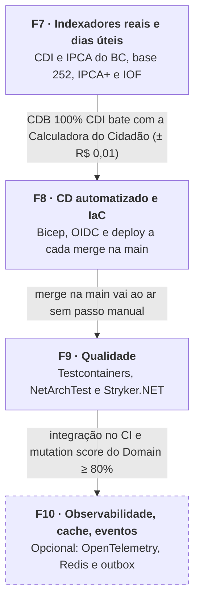

# Roadmap v2 — renda-fixa-api

Atualizado em 30/10/2026.

## Objetivo

A v1 (F1 a F6) entregou a API com taxas fixas no `appsettings.json`. A v2 dá o próximo passo: o sistema passa a usar dados de mercado reais, faz deploy sozinho e ganha testes que provam que os cálculos estão certos. A numeração continua a da v1. A ordem é F7, depois F8, depois F9. A F10 é opcional.

Como usar este roadmap:

- Uma fase por vez, como já manda o `CLAUDE.md`. A próxima só começa quando todos os critérios de conclusão da anterior estiverem marcados.
- Toda fase segue o mesmo fluxo das anteriores: `docs/SPEC-Fx-EXECUCAO.md`, depois os testes, depois o código, depois a skill `revisao-de-fase`.
- Cada fase fechada rende um post no LinkedIn e uma história para contar em entrevista.

## Como executar uma fase

No Claude Code, rode `/executar-fase F7` (ou F8, F9, F10). O comando, em `.claude/commands/executar-fase.md`, coordena quatro agentes de `.claude/agents/`:

| Agente | Papel |
|---|---|
| `especialista-renda-fixa` | revisa a spec contra as convenções de mercado, escreve os casos de referência dos testes e audita o cálculo implementado |
| `revisor-arquitetura` | confere camadas, pacotes, escopo, convenções do `CLAUDE.md` e qualidade dos testes |
| `implementador` | implementa passo a passo, sempre com o teste antes do código |
| `verificador-de-fase` | roda build, testes, cobertura e smoke test e registra cada critério com evidência em `docs/VALIDACAO-Fx.md` |

O comando para em dois pontos para você decidir: na aprovação da spec com os casos de referência e no fechamento da fase, antes do commit. Um critério só é marcado aqui quando o `VALIDACAO-Fx.md` traz a evidência.

## Visão geral

As fases F7 a F9 são o núcleo da v2. A F10 só entra se as vagas que você está mirando pedirem.

## Antes de começar: atualizar a fonte de verdade

O `docs/ESPECIFICACAO.md` coloca fora do escopo da v1 justamente o IOF e a integração com API de mercado. Como o `CLAUDE.md` proíbe inventar requisitos que não estejam na especificação, ela precisa mudar antes da F7.

- [x] Criar uma seção "Escopo v2" em `ESPECIFICACAO.md`, tirando de "Fora do escopo" o IOF e a integração com API de mercado. Marcação a mercado do Tesouro continua fora.
- [x] Adicionar as regras RN-08 a RN-11 em "Regras de negócio".
- [x] Adicionar F7 a F10 em "Fases" e registrar as novas escolhas em "Decisões técnicas".
- [x] Atualizar o `CLAUDE.md` onde a convenção muda: os testes de repositório saem do InMemory e passam para o Testcontainers na F9.
- [x] Fechar as decisões que travavam a F7: PreFixed em base 252, IPCA não divulgado estimado pela última variação publicada e taxas fixas do `appsettings.json` removidas.
- [ ] Commitar a especificação v2, o `CLAUDE.md`, o ROADMAP e a orquestração em `.claude/`.

## F7 — Indexadores reais e dias úteis

Comece pelo calendário de dias úteis. CDI acumulado, IPCA+ e IOF dependem de contar os dias úteis do jeito certo, então um erro ali contamina todo o resto.

### Passos

1. Escrever `docs/SPEC-F7-EXECUCAO.md` com as regras novas: RN-08 contagem de dias úteis (base 252), RN-09 pós-fixado em % do CDI, RN-10 IPCA+ e RN-11 IOF regressivo.
2. Montar o calendário no Domain: entidade `Holiday` com seed dos feriados nacionais da ANBIMA e uma classe `BusinessDayCalendar` com `CountBusinessDays(start, end)` e `NextBusinessDay(date)`. Ela não precisa de interface, porque não cruza camada.
3. Criar a série de indexadores: entidade `IndexRate (IndexType, ReferenceDate, Value)`, interface `IIndexRateProvider` no Application e implementação no Infrastructure chamando a API SGS do Banco Central (CDI série 12, IPCA série 433). A Selic ficou de fora porque nenhum `IndexType` usa.
4. Adicionar retry com `Microsoft.Extensions.Http.Resilience`, justificando o pacote novo na spec, como pede o `CLAUDE.md`.
5. Implementar um BackgroundService diário que busca a cotação do último dia útil. Ele precisa ser idempotente (upsert por data) e, na primeira execução, carregar o histórico.
6. Calcular o pós-fixado: fator diário = 1 + (CDI do dia × percentual contratado), acumulado por produtório. Definir na spec as casas decimais do fator diário e do acumulado seguindo a convenção da B3.
7. Calcular o IPCA+: taxa prefixada composta com a inflação do período. No mês sem IPCA divulgado, repetir a última variação publicada e marcar a projeção como estimada.
8. Aplicar o IOF regressivo: tabela de 30 dias (96% no dia 1, zero a partir do dia 30) cobrada sobre o rendimento antes do IR. O IR passa a incidir sobre o rendimento já sem o IOF, e o consolidado da RN-07 ganha `TotalIofAmount`.
9. Migrar o PreFixed para base 252 em dias úteis (RN-01) e remover a seção `IndexRates` do `appsettings.json` junto com o `IndexRatesOptions`. Os testes da v1 afetados recebem valores novos, conferidos à mão pelo especialista.
10. Expor `GET /api/indexes/{indexType}?from=&to=` e atualizar a projeção e o consolidado para usar os índices reais.

### Critérios de conclusão

- [ ] `SPEC-F7-EXECUCAO.md` commitada antes do primeiro commit de código da fase
- [ ] `CountBusinessDays` confere em três casos verificados à mão: um período com feriado nacional, a virada de ano e o Carnaval
- [ ] O job grava CDI e IPCA, e rodar duas vezes no mesmo dia não duplica registros
- [ ] Se a API do BC cair, a aplicação continua de pé: retry com backoff e erro registrado no log
- [ ] Um CDB 100% do CDI num período real bate com a Calculadora do Cidadão do BC, com diferença de no máximo R$ 0,01 sobre R$ 1.000
- [ ] Testes da v1 do PreFixed atualizados para base 252, com valores conferidos à mão e nenhum teste antigo removido sem substituto
- [ ] IOF testado nos dias 1, 15, 29 e 30, e LCI/LCA pagando IOF mesmo isentas de IR
- [ ] Cada RN nova tem testes (skill `testes-xunit`), com o cliente HTTP testado por um `HttpMessageHandler` stub `private sealed`, sem biblioteca de mock
- [ ] README explica as regras novas e traz um exemplo de chamada

## F8 — CD automatizado e IaC

Comece descrevendo em Bicep a infra que já existe (PostgreSQL Flexible Server, Container Apps e registry). O pipeline só é confiável se a infra puder ser recriada do zero. O build da imagem passa a rodar no runner do GitHub, o que também resolve o bloqueio de ACR Tasks da conta nova.

Escolhi Bicep porque é nativo do Azure e não exige gerenciar state. Se o foco for vaga, Terraform aparece mais nos anúncios: a decisão é sua antes de começar (item 1 de "Decisões em aberto" da especificação).

### Passos

1. Escrever `docs/SPEC-F8-EXECUCAO.md` com os ambientes, os gatilhos do pipeline e onde cada segredo fica guardado.
2. Criar `infra/main.bicep` com módulos para Log Analytics, registry, Container Apps Environment, Container App e PostgreSQL, parametrizados por ambiente.
3. Autenticar o GitHub no Azure via OIDC (federated credentials), sem senha ou client secret no repositório.
4. Criar o workflow `deploy.yml` ao lado do `ci.yml`: em push na `main`, depois do CI verde, faz o build da imagem, o push pro registry com a tag do SHA do commit e o `az containerapp update`.
5. Aplicar as migrations do EF Core com um migration bundle (`dotnet ef migrations bundle`) como etapa do pipeline, e não na inicialização da API.
6. Criar o endpoint `/health`, que hoje não existe no código, e usá-lo num smoke test depois do deploy: se não responder 200, o pipeline falha.
7. Guardar a connection string como secret do Container App (ou no Key Vault) e deixar mínimo de réplicas em zero para não gerar custo com a API parada.

### Critérios de conclusão

- [ ] O Bicep recria toda a infra num resource group vazio com um único `az deployment group create`
- [ ] Um merge na `main` publica a nova versão sem nenhum passo manual
- [ ] A imagem leva a tag do SHA, e dá para saber qual commit está rodando
- [ ] Nenhuma senha ou connection string aparece no repositório nem nos logs do Actions
- [ ] As migrations são aplicadas pelo pipeline
- [ ] Um smoke test que falha marca o deploy como falho
- [ ] O README tem o badge do deploy e um diagrama simples da infra

## F9 — Qualidade: Testcontainers, NetArchTest e Stryker

Comece pelo Testcontainers. É o que mais aumenta a confiança nos repositórios e no job de indexadores da F7, que hoje só são testados contra o InMemory.

### Passos

1. Escrever `docs/SPEC-F9-EXECUCAO.md`, justificando os pacotes novos (`Testcontainers.PostgreSql`, `NetArchTest.Rules`) e a ferramenta Stryker.NET.
2. Migrar os testes de repositório para `Testcontainers.PostgreSql`. O banco sobe por coleção de testes e as migrations rodam no setup. Usar o `WebApplicationFactory` que já está no projeto de testes da API para os testes de ponta a ponta.
3. Cobrir os repositórios, os endpoints principais e o job de indexadores, com a API do BC simulada por stub de `HttpMessageHandler`.
4. Escrever as regras de camada do `CLAUDE.md` com NetArchTest: o Domain não referencia nenhum outro projeto, o Application não referencia Infrastructure e os controllers não acessam o `DbContext`.
5. Rodar o Stryker.NET no projeto Domain, onde ficam os cálculos, e escrever testes que matem os mutantes sobreviventes.
6. Colocar os testes de integração no `ci.yml` (o runner Ubuntu já vem com Docker). O Stryker é lento, então fica num workflow separado, manual ou semanal.

### Critérios de conclusão

- [ ] Os testes de integração rodam com `dotnet test`, local e no CI, sem PostgreSQL instalado na máquina
- [ ] Violar uma regra de arquitetura de propósito quebra o build (testar uma vez e desfazer)
- [ ] Mutation score do Domain em pelo menos 80%
- [ ] O relatório do Stryker fica salvo como artifact do workflow
- [ ] Nenhum teste depende da ordem de execução ou dos dados de outro teste

## F10 — Observabilidade, cache e eventos (opcional)

Entre nesta fase só se as vagas que você estiver mirando pedirem esses itens. Cada um pode ser feito de forma independente.

- **Observabilidade:** OpenTelemetry com traces, métricas e logs indo para o Application Insights. O `/health` da F8 se divide em `/health/live` e `/health/ready`, com o ready checando o PostgreSQL.
- **Redis:** cache das séries de indexadores. Como o dado muda uma vez por dia, o TTL vai até o próximo dia útil.
- **Eventos:** publicar `ContributionMade` e `PositionMatured` usando outbox no PostgreSQL e um worker que envia para o Service Bus ou o RabbitMQ.

### Critérios de conclusão

- [ ] Uma requisição aparece como trace de ponta a ponta no Application Insights, da API até o banco
- [ ] A segunda consulta de indexador no mesmo dia não chega ao banco (conferido no trace)
- [ ] Com o broker fora do ar, o evento não se perde: fica no outbox e é enviado quando o broker volta

## Definição de pronto (vale para toda tarefa)

Uma tarefa só está concluída quando passa nos sete pontos abaixo, além dos critérios da fase.

1. A `ESPECIFICACAO.md` e a `SPEC-Fx-EXECUCAO.md` da fase estão atualizadas e batem com o que foi implementado.
2. `dotnet build` e `dotnet test` passam.
3. As regras novas têm testes, incluindo os casos de fronteira, e o CI está verde.
4. A `revisao-de-fase` rodou sem pendências.
5. O README está atualizado.
6. Existe um PR descrevendo o que mudou e por quê, mesmo trabalhando sozinho.
7. A partir da F8, a mudança está no ar no Azure e funcionando.

## Primeiro passo

Commitar a base da v2. Depois disso, rodar `/executar-fase F7` no Claude Code.
