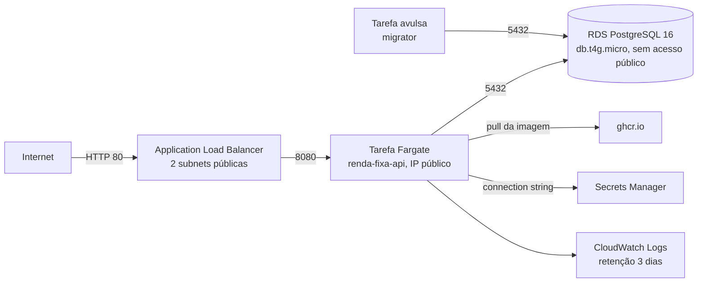

# Spec de execução — F11: Nuvem na AWS com Terraform

Status: aprovada pelo Matheus em 19/11/2026, com as decisões D1 a D6 como propostas.
Revisão do `revisor-arquitetura` no fim do documento.

Documento de execução para agente. Objetivo: descrever em Terraform um ambiente AWS
**efêmero** para a API (ECS Fargate, Application Load Balancer e RDS PostgreSQL), validá-lo
primeiro sem conta na AWS, contra o emulador Floci, e depois subir de verdade só durante uma
demo, com destruição automática garantida. Substitui o caminho Azure de
`docs/RASCUNHO-IAC-AZURE.md`, que continua como histórico.

Marcação usada: **(verificar no Px)** indica comportamento da AWS, do Terraform, do GitHub ou
do Floci que a revisão não conseguiu provar no repositório. O passo indicado confere na
documentação da versão fixada ou na execução e registra a evidência no relatório. Se a
verificação contradisser a spec, o passo para e a decisão volta para o Matheus.

## Contexto

A especificação funcional está em `docs/ESPECIFICACAO.md` e as convenções em `CLAUDE.md`;
ambas prevalecem. Esta fase não tem regra de negócio nem cálculo novos: não há RN nova e o
`especialista-renda-fixa` não entra.

O que já existe e é reaproveitado sem mudança de comportamento:

- `release.yml` publica a cada merge na `main` a imagem `ghcr.io/matheuscardosolazzarini/renda-fixa-api`
  com a tag do SHA (rótulo `org.opencontainers.image.revision`) e, depois do smoke, a `latest`
- O job `bundle` do `release.yml` gera o migration bundle self-contained `linux-x64` e o
  publica como artefato; o smoke aplica esse artefato baixado (`release.yml:37-83`, `:154-163`)
- `GET /health` responde 200 sem consultar o banco (`Program.cs:149-152`)
- A API lê a conexão só de `ConnectionStrings__DefaultConnection` (`Program.cs:16-17`); o
  bundle exige a mesma variável mesmo com `--connection` (`FixedIncomeDbContextFactory.cs:20`,
  `:33-37`)
- A importação de índices roda dentro da API, **na partida e depois a cada 6 h**
  (`IndexRatesImportJob.cs:13`, `:31-38`), e recarrega o histórico do BC numa base vazia.
  Perder o banco ao destruir o ambiente não perde nada que não volte sozinho, **desde que as
  migrations já estejam aplicadas quando a API sobe**: senão a importação da partida falha por
  falta da tabela `index_rate` e só tenta de novo em 6 h (`README.md:530-533`). Por isso a
  ordem de subida da D3 é obrigatória

Esta fase toca:

- `infra/aws/` (novo): Terraform, tfvars sem segredo, testes do Terraform, script de bootstrap,
  script de verificação de zerado e o script da trava de custo
- `Dockerfile.migrator` (novo, na raiz): imagem de migração montada a partir do bundle (D3).
  O `Dockerfile` atual **não muda**
- `.github/workflows/infra-aws.yml` (novo)
- `.github/workflows/release.yml`: build, smoke e push da imagem de migração (D3) e
  `paths-ignore` de `infra/**` e do `infra-aws.yml`
- `.github/dependabot.yml`: `ignore` de major para `dotnet/runtime-deps`
- `README.md`, `docs/ROADMAP.md`, `docs/ESPECIFICACAO.md` (escopo, "Fases" e "Decisões
  técnicas": F11, AWS, Floci, ambiente efêmero), `CLAUDE.md` e
  `.claude/commands/executar-fase.md` (F11 na lista de fases e na Etapa 2) e `.gitignore`

## Premissa de custo: nada fica ligado esquecido

Esta é a regra mais importante da fase e vale acima de qualquer outra. Ela é garantida em
camadas, de modo que a falha de uma delas não gere cobrança:

| Camada | O que faz | Depende do GitHub? |
|---|---|---|
| 1. Plano gratuito da conta | Conta criada em **"Sign up for AWS (advanced)" com o Free account plan** (D5). No plano gratuito a AWS não cobra: o pior caso é consumir os créditos e a conta ser encerrada. Nunca fazer upgrade, nunca entrar no AWS Organizations, nunca criar landing zone do Control Tower nem IAM Identity Center em modo de organização: qualquer um deles faz upgrade automático para o plano pago | Não |
| 2. Ambiente efêmero | Tudo o que custa por hora (ALB, RDS, tarefas Fargate, IPv4 públicos, secret) sobe e desce junto, no mesmo state. O que o bootstrap cria (bucket do state, budget, IAM, provedor OIDC) não cobra por hora | — |
| 3. TTL com destruição automática | Todo `subir` grava `expires_at` (padrão 4 h, máximo 12 h). Um workflow agendado a cada 30 min destrói o ambiente vencido. Um job de limpeza destrói o ambiente quando o `subir` falha ou é cancelado | Sim |
| 4. Verificação de zerado | Script que lista na conta todo tipo de recurso pago da tabela "Resíduos" e falha se achar qualquer um. Roda depois de todo `destroy` **e em todo ciclo agendado sem ambiente ativo**, olhando a conta, não o state | Sim |
| 5. Orçamento com alerta | AWS Budgets **criado no bootstrap** (nunca pelo workflow), de US$ 5 por mês, com `include_credit = false` (o uso bruto, antes dos créditos) e e-mail com custo real em US$ 1, US$ 3 e US$ 5 | Não |
| 6. Trava de custo | Duas partes independentes: (a) o plano JSON só pode ter tipos de recurso de uma **lista positiva** e atributos dentro dos limites; roda no PR e no `subir`, antes do `apply`. (b) A policy da role do CI **nega** explicitamente as ações caras (NAT, Elastic IP, EC2, VPC endpoint, KMS, RDS fora de `db.t4g.micro` ou Multi-AZ), em qualquer região | (a) sim, (b) não |

Limites honestos:

- Só as camadas 1, 5 e 6b independem do GitHub. Os dados de faturamento atrasam de horas a um
  dia, então o alerta da camada 5 chega com atraso de um dia, não de minutos
  (verificar no P8)
- O Free account plan dura 6 meses ou até acabarem os créditos, e a conta fecha. A data de
  fechamento vai para o README; ao fechar, o workflow é desligado pela guarda da variable
  `AWS_ROLE_ARN` (ver Pipeline)
- O GitHub desativa workflows agendados de repositório público depois de 60 dias sem
  atividade no repositório (verificar no P6). `subir` e o agendado ficam **no mesmo arquivo**:
  um workflow desativado também não sobe nada. O caso de borda (subir no dia 59) é coberto
  por uma guarda no `subir` (ver Pipeline)

### Resíduos que podem ficar e como cada um é tratado

| Resíduo | Tratamento |
|---|---|
| Tarefa ECS avulsa de migração (fora do state) | `stop-task` em passo `if: always()`; `--propagate-tags TASK_DEFINITION`; a verificação de zerado lista tarefas em qualquer cluster |
| IPv4 público de ENI (tarefas e ALB), que não é Elastic IP | A verificação lista ENIs com IPv4 público associado e endereços IPv4 públicos da conta |
| Secret em janela de recuperação (padrão de 30 dias, verificar no P3) | `recovery_window_in_days = 0`; a verificação lista também secrets agendados para exclusão |
| Log group | Criado pelo Terraform com retenção de 3 dias e referenciado pela task definition pelo atributo do recurso; sem `enabled_cloudwatch_logs_exports` no RDS, sem Container Insights. A verificação lista os log groups do projeto |
| Snapshot e backup automático do RDS | `skip_final_snapshot = true`, `backup_retention_period = 0`, `delete_automated_backups = true`. A verificação lista snapshots manuais e backups automáticos retidos |
| Chave KMS gerenciada pelo cliente | Proibida: RDS e Secrets Manager usam as chaves gerenciadas pela AWS. A trava 6a reprova `aws_kms_key` e a 6b nega `kms:CreateKey`; a verificação lista chaves de cliente |
| Versões antigas do state no bucket versionado | `noncurrent_version_expiration` de 7 dias no bucket. Com a D6, o state não tem senha |
| Lock do state preso | `-lock-timeout` em todo comando; o agendado fica vermelho enquanto o lock não sai; README com `terraform force-unlock` |
| Tags de candidatas no GHCR (R-15) | A imagem de migração dobra o acúmulo. Sem custo; anotado no R-15 do ROADMAP |
| Recursos antigos da Azure (`rg-renda-fixa`) | Fora desta conta. Nunca reativar a assinatura sem apagá-los antes (ROADMAP, "Adiado") |

### Estimativa por hora

Com tudo ligado em `us-east-1`, a conferir no Cost Explorer na validação ao vivo: ALB
~US$ 0,023 + LCU, RDS `db.t4g.micro` ~US$ 0,016, Fargate 0,25 vCPU / 0,5 GB ~US$ 0,012 e
IPv4 públicos ~US$ 0,005 cada (2 do ALB, um por AZ, e 1 da tarefa; a migração acrescenta um
transitório). Ordem de grandeza: US$ 0,30 por demo de 4 h. No plano gratuito, isso é
consumo de crédito, não cobrança.

## Fora de escopo

- Domínio próprio, HTTPS no ALB e certificado (a demo usa o DNS HTTP do ALB)
- NAT gateway, subnets privadas com saída para a internet, VPC endpoints
- Multi-AZ no RDS, réplica, backup, snapshot final
- Auto scaling: uma tarefa só (o job de importação precisa de instância única)
- Ambiente permanente de qualquer tipo
- `/health/ready` checando o banco (F10)
- Autenticação: a especificação não a tem. Risco aceito e registrado no README: durante a
  janela da demo, qualquer pessoa com o DNS grava dados; o banco é destruído no fim
- Qualquer mudança em regra de negócio, cálculo, contrato de API, código .NET, `Dockerfile`,
  `ci.yml` ou `mutation.yml`

## Decisões para aprovação do Matheus

**D1 — Nome da fase.** A F10 (observabilidade, opcional) continua como está. Proposta: esta
fase vira **F11 — Nuvem na AWS**. A seção "Adiado: publicação em nuvem com Terraform" do
ROADMAP passa a apontar para ela; a `ESPECIFICACAO.md` ganha a F11 em "Fases" e deixa de dizer
que IaC está adiada (`:29-30`, `:283`). A D1 precisa estar aprovada antes do P1.

**D2 — Ambiente totalmente efêmero.** Alternativa avaliada: deixar VPC, RDS e cluster
permanentes e ligar só o ALB e o serviço na demo. Rejeitada: o RDS sozinho cobra por hora, e
uma base permanente reabre o risco que a fase quer eliminar. Custo aceito: cada demo começa
com banco vazio e a API leva alguns minutos para importar o histórico do BC.

**D3 — Como as migrations chegam ao RDS, e em que ordem.** O RDS fica sem acesso público,
então o runner do GitHub não alcança o banco para rodar o bundle. Proposta:

- Imagem de migração `ghcr.io/.../renda-fixa-api:<sha>-migrator`, montada por um
  `Dockerfile.migrator` **separado**, cujo contexto é só o artefato `efbundle` já baixado pelo
  job `release`: base `mcr.microsoft.com/dotnet/runtime-deps:8.0` (o bundle é
  self-contained), `chmod +x`, usuário sem privilégio, `ENTRYPOINT ["/app/efbundle"]`. Assim
  a imagem carrega o mesmo artefato que o smoke prova, e o `Dockerfile` da API e o alvo padrão
  do `docker build .` ficam intactos
- O smoke do `release.yml` passa a aplicar as migrations **rodando a imagem de migração**
  contra o PostgreSQL do service container (no lugar de executar o bundle solto), e só então
  sobe a API. A imagem de migração é empurrada com a tag do SHA junto com a candidata
- No `subir`, a ordem é: `apply` com `service_desired_count = 0`; tarefa ECS avulsa de
  migração; segundo `apply` com `service_desired_count = 1`; espera do serviço estável;
  smoke. Nunca `aws ecs update-service` por fora, que criaria drift
- API e migração usam sempre o **mesmo SHA** (ver "Imagens e SHA"); o ECS nunca recebe tag
  mutável

Alternativas rejeitadas: aplicar migrations na partida da API (a F8 já descartou); um estágio
`migrator` no `Dockerfile` atual (vira o alvo padrão do `docker build .` do `release.yml` se
ficar por último, não tem o `.config/dotnet-tools.json` no contexto e geraria um segundo
bundle diferente do que o smoke prova).

**D4 — TTL.** Padrão de 4 h, máximo de 12 h. O workflow calcula `expires_at` uma vez e o passa
por `-var`; a variável valida RFC 3339 e
`timecmp(var.expires_at, timeadd(plantimestamp(), "12h")) <= 0`. O valor fica num output e
numa tag do cluster, **não** em `default_tags` (senão prorrogar re-etiquetaria todos os
recursos). Prorrogar é rodar o `subir` de novo. A fase 0 do `subir` grava um prazo **provisório**
(agora + 1 h, ou o definitivo, se for menor) e o definitivo só entra no `apply` da fase 1 (I3 da
rodada 1 de correção, ver "Decisões de implementação").

**D5 — Conta e região.** Conta criada em **"Sign up for AWS (advanced)"** com o **Free account
plan**: é nessa experiência que a região é escolhida. A experiência "new" atribui a região pelo
país (Brasil vai para `us-east-2`), faz opt-in no AWS Organizations e só oferece o limite de
gasto no plano pago, então não serve. Região `us-east-1`, a mais barata e com todos os
serviços, como variável com esse padrão. `sa-east-1` daria menos latência a partir de Suzano e
custa mais; para uma demo, a latência não pesa. O P0 confirma na conta criada que a região é
selecionável e que ECS, ELB, RDS, Secrets Manager, CloudWatch Logs e Budgets estão
disponíveis no plano; se não estiverem, a fase para.

**D6 — Senha do banco fora do state.** A regra já adotada vale aqui: nenhum segredo vai para o
state em texto aberto quando houver alternativa (`RASCUNHO-IAC-AZURE.md:101-112`). Como a API
lê só a connection string inteira e esta fase não muda código .NET, duas opções mantêm a senha
fora do state:

- **Opção B (recomendada): escrita única.** `ephemeral "aws_secretsmanager_random_password"`
  gera a senha a cada execução; `aws_db_instance` recebe `password_wo` com
  `password_wo_version = 1`; o secret `renda-fixa-api/connection-string` recebe
  `secret_string_wo` com a connection string montada (host do `aws_db_instance.address`) e
  `secret_string_wo_version = 1`. A task definition injeta esse secret inteiro em
  `ConnectionStrings__DefaultConnection` pela execution role. A imagem não muda. Exige
  Terraform ≥ 1.11 e um provider `aws` que tenha os dois argumentos (verificar no P1). Como a
  versão de escrita não muda entre `apply`s do mesmo ambiente, prorrogar o TTL não reescreve
  senha nem secret
- **Opção A (reserva): segredo gerenciado pelo RDS.** `manage_master_user_password = true`; a
  task definition injeta a chave `password` do secret do RDS em `DB_PASSWORD` e recebe host,
  banco e usuário em `environment`; `entryPoint` com `sh -c` monta
  `ConnectionStrings__DefaultConnection` (senha entre aspas duplas, que o gerador do RDS não
  usa, verificar no P3) e faz `exec dotnet FixedIncome.Api.dll` (na migração, `exec
  /app/efbundle`). Usada só se a Opção B não for viável no provider fixado

Em qualquer opção: nenhum data source de secret, nenhum `random_password`, nenhum output com
senha. Se nenhuma das duas for viável, o P3 para e a decisão volta ao Matheus; a senha no
state não é caminho automático. A prova de "senha fora do state" é local (`terraform show
-json` contra o state, procurando a senha e a connection string), **nunca no Actions**, que
imprimiria valores sensíveis.

## Regras da fase

### Arquitetura

### Rede

- VPC com duas subnets públicas em AZs diferentes (o ALB e o subnet group do RDS exigem duas)
  e internet gateway. Nenhuma subnet privada com rota para fora
- Security groups em cadeia: ALB aceita 80 de qualquer origem; tarefa aceita 8080 só do SG do
  ALB; RDS aceita 5432 só do SG da tarefa. A tarefa de migração usa o **mesmo SG da tarefa**
- Tarefas com `assign_public_ip = true`: é o que permite puxar a imagem do GHCR sem NAT. O SG
  não aceita nada da internet, então o IP público serve só para saída
- Saída restrita (correção de segurança de 21/11/2026, ver a seção própria): a tarefa só sai em 443
  para a internet e em 5432 para o SG do RDS

### Banco

- PostgreSQL 16, `db.t4g.micro`, 20 GB gp3, single-AZ, `publicly_accessible = false`,
  `storage_encrypted = true` com a chave gerenciada pela AWS
- `skip_final_snapshot = true`, `deletion_protection = false`, `backup_retention_period = 0`,
  `delete_automated_backups = true`, `monitoring_interval = 0`, Performance Insights
  desligado, sem `enabled_cloudwatch_logs_exports`. Se o plano gratuito exigir retenção maior
  que zero (verificar no P0), a retenção fica no mínimo aceito e a verificação de zerado
  continua listando backups retidos
- Senha conforme a D6. A connection string não define `SSL Mode=Disable`: o RDS 16 exige TLS
  por padrão (verificar no P8) e o padrão do Npgsql (`Prefer`) negocia TLS

### Aplicação

- Cluster com Container Insights desligado. Duas task definitions (0,25 vCPU, 0,5 GB,
  `linux/amd64`), ambas com a mesma execution role, o mesmo log group (prefixos de stream
  diferentes) e `ConnectionStrings__DefaultConnection` vinda do secret (D6):
  - `renda-fixa-api`: imagem `<sha>`, `ASPNETCORE_ENVIRONMENT=Production`, porta 8080
  - `renda-fixa-migrator`: imagem `<sha>-migrator`. Fica no Terraform para ser destruída junto
- Sem task role: a API não chama nenhum serviço da AWS
- Serviço com `desired_count = var.service_desired_count` (padrão 0, D3),
  `deployment_circuit_breaker` com rollback, `health_check_grace_period_seconds` suficiente
  para a partida (definir no P3), `propagate_tags = "SERVICE"`
- ALB com `enable_deletion_protection = false`; target group `target_type = "ip"`, health
  check em `/health`, `deregistration_delay` de 10 s (o padrão de 300 s alonga o destroy);
  listener HTTP 80
- Com `ASPNETCORE_ENVIRONMENT=Production` o Swagger fica desligado (`Program.cs:122-126`) e `/`
  responde 404 com o envelope. O que mostrar na demo e no print é decidido pelo Matheus no P8

### Imagens e SHA

- Entrada opcional `sha` no `subir` (40 caracteres hexadecimais). Sem ela, o workflow resolve a
  `latest` para o SHA pelo rótulo `org.opencontainers.image.revision`
  (`docker buildx imagetools inspect`, formato exato verificar no P6)
- Antes do primeiro `apply`, o workflow confere **sem login** que `<sha>` e `<sha>-migrator`
  existem no GHCR. Isso prova também que o pacote é público. Falta de qualquer uma reprova o
  `subir` antes de criar qualquer coisa (as candidatas anteriores a esta fase não têm
  `-migrator`: o primeiro `subir` exige um merge com o `release.yml` novo)
- Terraform recebe `image_sha` por variável e monta as duas referências. Nenhuma tag mutável
  chega ao ECS

### Segredos e identificadores

| Item | Onde fica | Observação |
|---|---|---|
| Senha do PostgreSQL | Em lugar nenhum fora do RDS e do secret (D6) | Gerada por recurso efêmero a cada ambiente |
| Connection string | Secret `renda-fixa-api/connection-string` (Opção B) | Injetada pela execution role; nunca no state, em output ou em log |
| `AWS_ROLE_ARN`, `AWS_REGION`, `TF_STATE_BUCKET` | `AWS_ROLE_ARN` é variable de **repositório**; `AWS_REGION` e `TF_STATE_BUCKET` são variables do environment `aws` | São identificadores. `AWS_ROLE_ARN` fica no repositório porque o `if` do job é avaliado antes de o job entrar no environment; é seguro porque o trust da role exige `sub = repo:...:environment:aws` |
| Credencial da AWS no GitHub | Nenhuma: OIDC | Sem chave de acesso |
| State | Bucket S3 do bootstrap | Privado, SSE-S3, versionado com expiração de versões antigas |

O plano salvo (`-out`) contém variáveis sensíveis: `plan` e `apply` rodam no mesmo job, o
arquivo nunca vira artifact, e o JSON da trava de custo vai direto para o `jq`, sem ser
impresso nem salvo.

### Estrutura de `infra/aws/`

- `versions.tf`: `required_version = "~> 1.11"` (escrita única e `use_lockfile`), provider
  `hashicorp/aws` em faixa menor; `.terraform.lock.hcl` commitado, gerado com
  `terraform providers lock -platform=linux_amd64 -platform=windows_amd64`. Nenhum outro
  provider
- `backend.tf`: `backend "s3" {}` com configuração parcial em `environments/aws.backend.hcl`
  (`use_lockfile = true`, sem segredo)
- `providers.tf`: só a configuração real, com `region = var.region` e `default_tags`
  (`project=renda-fixa-api`, `managed_by=terraform`). **Sem** variável `use_floci` nem ramo de
  emulador: o job do Floci gera um `floci_override.tf` (no `.gitignore`) que troca o backend
  por `local` e acrescenta ao provider os endpoints do Floci, os `skip_*` e credenciais
  fictícias (substituição de backend e provider por arquivo de override: verificar no P1)
- Variáveis: `region`, `expires_at`, `image_sha` (com `validation`), `service_desired_count`
  (padrão 0, `validation` 0 ou 1). Outputs: DNS do ALB, `expires_at`, `image_sha`, nomes do
  cluster, das subnets e do SG da tarefa (usados pela migração). Nenhum output sensível
- Módulos: `network`, `database`, `app` (ECS, ALB, logs, secret). Não há módulo de budget
- `environments/aws.tfvars` e `environments/floci.tfvars`, sem segredo
- `tests/*.tftest.hcl` com `mock_provider` (ver Testes)
- `bootstrap/bootstrap.sh`, `scripts/verificar-zerado.sh` e `scripts/trava-custo.sh`
- `.gitignore`: exceção `!infra/aws/environments/*.tfvars`, `*.tfplan` e
  `infra/aws/floci_override.tf`

### Bootstrap (`infra/aws/bootstrap/`)

Script único (bash com `aws`), idempotente, rodado uma vez pelo Matheus **no CloudShell** da
conta, com MFA no usuário root e sem criar chave de acesso. Imprime só identificadores. Cria:

- Bucket do state: Block Public Access, SSE-S3 (não KMS de cliente), versionamento,
  `noncurrent_version_expiration` de 7 dias e policy que nega acesso sem TLS
- Provedor OIDC do GitHub e a role `renda-fixa-gha` com `MaxSessionDuration` de 2 h e trust
  com `StringEquals` em `token.actions.githubusercontent.com:aud = sts.amazonaws.com` e
  `token.actions.githubusercontent.com:sub =
  repo:matheuscardosolazzarini/renda-fixa-api:environment:aws` (sem `StringLike`)
- A execution role `renda-fixa-api-execution`, com trust em `ecs-tasks.amazonaws.com` e
  permissão só para escrever logs no log group do projeto e ler os secrets `renda-fixa-api/*`
  (na Opção A, `rds!db-*`)
- As service-linked roles de ECS, Elastic Load Balancing e RDS, se ainda não existirem (numa
  conta nova a primeira criação as exige, verificar no P0)
- O budget da camada 5, com o e-mail de alerta. O Matheus confirma a assinatura do e-mail

### Permissões da role do CI (`renda-fixa-gha`)

Policy enumerada, sem `*:*`, sem `AdministratorAccess`, sem `iam:Create*`, `iam:Put*`,
`iam:Attach*` nem `budgets:*`:

- Escrita só nas ações de `ec2` de VPC, subnet, internet gateway, route table, security group
  e tags; em `elasticloadbalancing`, `ecs`, `rds`, `logs` e `secretsmanager`, limitadas pela
  condição `aws:RequestedRegion = us-east-1`. A lista exata de ações é derivada no P1 a P3 e
  registrada; curinga de serviço inteiro só onde a lista não couber, com o motivo
- `iam:PassRole` só no ARN da execution role, com `iam:PassedToService =
  ecs-tasks.amazonaws.com`
- `ecs:RunTask` só na task definition `renda-fixa-migrator:*`, com `ArnEquals ecs:cluster` no cluster do
  projeto; `ecs:StopTask` só em `task/renda-fixa-api/*` (S2)
- S3 só no bucket do state, nas chaves do state e do `.tflock` (Get, Put, Delete) e
  `ListBucket` no bucket
- Leitura (`Describe*`, `List*`, `tag:GetResources`) para a verificação de zerado
- **Deny explícito** (camada 6b), em qualquer região: `ec2:CreateNatGateway`,
  `ec2:AllocateAddress`, `ec2:RunInstances`, `ec2:CreateVpcEndpoint`,
  `ec2:CreateTransitGateway`, `kms:CreateKey`, `route53:CreateHostedZone`; e
  `rds:CreateDBInstance` quando `rds:DatabaseClass` não for `db.t4g.micro` ou `rds:MultiAz`
  for verdadeiro (chaves de condição: verificar no P1)

### Verificação de zerado (`scripts/verificar-zerado.sh`)

Sai com código diferente de zero se achar, na região, qualquer um destes; imprime só tipo e
identificador:

- Serviços ECS e tarefas em execução em qualquer cluster (`list-clusters`, `list-tasks`)
- Load balancers e target groups
- Instâncias RDS, snapshots manuais e backups automáticos retidos
- NAT gateways, Elastic IPs, ENIs com IPv4 público associado, instâncias EC2 e VPC endpoints
- Secrets, incluindo os agendados para exclusão (`--include-planned-deletion`)
- Log groups com prefixo do projeto
- Chaves KMS gerenciadas pelo cliente
- Qualquer recurso com `project=renda-fixa-api` (`resourcegroupstaggingapi get-resources`). Task
  definition (INACTIVE depois do destroy) vira `AVISO`; tarefa só vira `AVISO` se o `describe-tasks`
  confirmar STOPPED ou inexistente (I1)

Não depende só de tag. Os recursos do bootstrap (bucket, roles, provedor OIDC, budget) não
entram na lista.

### Trava de custo (`scripts/trava-custo.sh`, camada 6a)

Recebe o JSON do plano pela entrada padrão e reprova se:

- Houver tipo de recurso fora da lista positiva (`aws_vpc`, `aws_subnet`,
  `aws_internet_gateway`, `aws_route_table`, `aws_route_table_association`,
  `aws_security_group`, as regras de SG, `aws_lb`, `aws_lb_target_group`, `aws_lb_listener`,
  `aws_ecs_cluster`, `aws_ecs_task_definition`, `aws_ecs_service`, `aws_db_subnet_group`,
  `aws_db_instance`, `aws_secretsmanager_secret`, `aws_secretsmanager_secret_version`,
  `aws_cloudwatch_log_group`; a lista final é fechada no P5)
- Algum atributo sair do limite: `instance_class = db.t4g.micro`, `multi_az = false`,
  `allocated_storage <= 20`, `backup_retention_period = 0` (ou o mínimo do P0),
  `desired_count <= 1`, CPU 256 e memória 512 nas task definitions, retenção do log group 3
- Passar do que o ambiente comporta (S1): no máximo 1 `aws_db_instance`, 1 `aws_lb`, 1
  `aws_ecs_service` e 2 `aws_ecs_task_definition`; `load_balancer_type = application`;
  `storage_type = gp3` e sem `iops` acima do incluso (3000); `replica` vazio no secret; valor
  desconhecido (`after_unknown`) nos atributos de valor exato
- Deixar ligada uma proteção que impede o destroy ou deixa resíduo, ou um recurso de custo contínuo (R-B1,
  rodada 3): RDS com `deletion_protection`, sem `skip_final_snapshot`, sem `delete_automated_backups` ou com
  `enabled_cloudwatch_logs_exports`; ALB com `enable_deletion_protection`; secret com
  `recovery_window_in_days` diferente de 0; cluster ECS sem a `setting` `containerInsights = disabled`

### Pipeline (`.github/workflows/infra-aws.yml`)

Regras gerais, no padrão do `release.yml` e do `ci.yml`:

- `permissions: contents: read` no nível do workflow; `id-token: write` só nos jobs que falam
  com a AWS; ações fixadas por SHA com comentário da versão; `persist-credentials: false`;
  `timeout-minutes` em todo job
- Entradas e contextos entram no shell só por `env:`; `horas` validada como inteiro de 1 a 12
  e `sha` como 40 hexadecimais antes de qualquer uso
- Jobs que falam com a AWS: `environment: aws`, guarda `if: vars.AWS_ROLE_ARN != ''` (sem ela,
  o agendado ficaria vermelho entre o merge do workflow e o bootstrap, e de novo depois que a
  conta fechar), `aws-actions/configure-aws-credentials` por OIDC com
  `role-duration-seconds: 7200`, e `-lock-timeout=5m` em todo comando do Terraform
- Environment `aws` com deployment branch policy só para `main` e **sem** required reviewers
  (com reviewers o destroy agendado ficaria esperando aprovação e o TTL morreria). Os jobs
  manuais também exigem `github.ref == 'refs/heads/main'`

Jobs:

- **`validar`** (`pull_request` com `paths: infra/aws/**`, o próprio workflow e o `README.md`; sem
  environment, sem `id-token`, sem AWS): `fmt -check -recursive`, `init -backend=false`,
  `validate`, `terraform test`, `actionlint` e `zizmor` no workflow, e o ciclo no Floci (ver
  "Floci"): gera o override, `apply` com `floci.tfvars` e `service_desired_count = 0`, trava de
  custo sobre o plano, `destroy`, verificação de zerado contra o Floci. Imagem do Floci fixada
  por digest como o `postgres:16` do `release.yml:103-105`
- **`subir`** (`workflow_dispatch`, `acao = subir`, concurrency `infra-aws-manual`):
  1. Guardas: entradas válidas; último commit da `main` com menos de 45 dias (senão o agendado
     pode ser desativado no meio do TTL: o job falha pedindo um commit); resolve o SHA; confere
     as duas imagens no GHCR sem login
  2. Calcula `expires_at` (definitivo) e o prazo provisório (I3); `init`; `plan -out` com
     `service_desired_count = 0` e o prazo provisório; trava de custo; bloqueio de recriação do
     RDS e da versão do secret (S5); `apply` do plano
  3. Migração: `aws ecs run-task` da `renda-fixa-migrator` com subnets e SG dos outputs,
     `assignPublicIp=ENABLED` e `--propagate-tags TASK_DEFINITION`. Falha se `failures[]`
     vier preenchido ou `tasks[]` vazio. Espera com prazo próprio de 10 min medido pelo shell
     (o `aws ecs wait tasks-stopped` desiste por conta própria, verificar no P6). Exige
     `containers[0].exitCode == 0`; `exitCode` nulo é falha, e o job imprime `stopCode`,
     `stoppedReason` e `aws logs tail` do stream da migração. `stop-task` em passo
     `if: always()`
  4. `plan -out` com `service_desired_count = 1` e o prazo definitivo; trava de custo;
     bloqueio de recriação; `apply`
  5. Espera, com prazo próprio, o serviço estável e o alvo `healthy` no target group
  6. Smoke no DNS do ALB com `curl --retry --retry-all-errors`: `/health` e `/api/assets`
  7. `plan -detailed-exitcode` com as mesmas variáveis: precisa sair 0 (sem diferença)
  8. Resumo do job com DNS do ALB, SHA e `expires_at`
- **`destruir`** (`workflow_dispatch`, `acao = destruir`, concurrency `infra-aws-manual`):
  lê `expires_at` e `image_sha` com `terraform output -raw` (ausentes viram valores de
  marcação aceitos pela `validation`), `destroy`, verificação de zerado
- **`limpar`** (`needs: [subir, destruir]`, `if: failure() || cancelled()`, credencial OIDC
  nova): para tarefas da família `renda-fixa-migrator`, `destroy`, verificação de zerado. Fica
  vermelho se sobrar qualquer coisa
- **`agendado`** (`schedule` a cada 30 min, concurrency `infra-aws-agendado`, com
  `actions: read`):
  1. Se houver execução manual do `infra-aws` em andamento ou na fila (`gh run list`), termina
     com aviso e deixa para o próximo ciclo (evita ler um state no meio do `apply`)
  2. `init`; erro de leitura do state é **vermelho**
  3. `terraform state list` vazio: não há ambiente ativo; roda a verificação de zerado contra a
     conta e fica vermelho se achar algo
  4. Com state: lê `terraform output -raw expires_at`. Ausente, inválido ou vencido conta como
     vencido: `destroy` e verificação de zerado. Não vencido: termina verde com o tempo
     restante no resumo

O GitHub notifica o dono quando uma execução agendada falha. `concurrency` com
`cancel-in-progress: false` nos dois grupos. O agendado fica em grupo próprio porque a fila do
`concurrency` guarda só a execução pendente mais recente (`release.yml:22-24`): no mesmo grupo,
um cron descartaria um `destruir` manual que esperava. A serialização entre eles vem do lock
do state e da guarda do passo 1. Cron a cada 30 min dá ~1.440 execuções por mês: sem custo em
repositório público, mas estouraria a franquia se o repositório ficasse privado (README).

### `release.yml`

- `paths-ignore` ganha `infra/**` e `.github/workflows/infra-aws.yml` (PR só de infra não gera
  imagem). O `Dockerfile.migrator` fica na raiz justamente para continuar disparando a release
- Depois do download do bundle: `docker build -f Dockerfile.migrator` com contexto
  `artifacts/`, tag `<sha>-migrator` e os mesmos rótulos `source` e `revision`
- O passo "aplicar bundle no banco limpo" passa a rodar a imagem de migração com
  `--network host` e a mesma variável de conexão
- Push da `<sha>-migrator` junto com o push da candidata. A `latest` continua só para a API

## Floci: o que prova e o que não prova

Pelo README do Floci (consultado online na revisão): ECS e RDS rodam em Docker; ELBv2 aparece
na lista de serviços sem dizer se roteia tráfego ou faz health check; security groups não
filtram tráfego por padrão; NAT e roteamento de VPC não são emulados; nada sobre aplicação de
IAM, Fargate, pull de registry externo, injeção de `secrets` ou driver `awslogs`; custos são
sintetizados. O ROADMAP já registrou que Terraform que nunca rodou contra um ambiente real não
prova nada (`ROADMAP.md:102`). Por isso:

- **O Floci prova:** que a configuração aplica e destrói sem erro numa API compatível, com
  `service_desired_count = 0`; que a trava de custo lê um plano real; que a verificação de
  zerado chama as APIs certas e reprova um recurso sobrando
- **O Floci não prova, e nenhum critério depende disso:** tarefa rodando, ALB roteando, health
  check, cadeia de SGs, IAM, OIDC, injeção do secret, logs, custo
- `plan` sem diferença no Floci é informativo, não critério. É proibido acrescentar
  `ignore_changes` ou condicional para acomodar o emulador; divergência do Floci vai para o
  relatório
- Tudo o que o Floci não prova vira critério ao vivo

## Implementação em passos

Terraform e workflows não têm teste .NET; o equivalente é `fmt`, `validate`, `terraform test`,
o ciclo no Floci, `actionlint`, `zizmor` e a leitura do `plan`, registrados no relatório. O
`dotnet build` e o `dotnet test` continuam verdes e a contagem não cai.

- **P0 — Conta** (com o Matheus; cada escrita só com autorização dele naquele momento).
  Criar a conta em "Sign up for AWS (advanced)" com o Free account plan e MFA no root;
  confirmar o plano na tela de billing, a região selecionável, os serviços disponíveis, a
  retenção mínima de backup do RDS e se as service-linked roles precisam ser criadas. Sem
  isso, os passos de nuvem não começam; P1 a P6 podem seguir com o Floci
- **P1 — Esqueleto** (Sonnet). `versions.tf`, `backend.tf`, `providers.tf`, variáveis com
  `validation`, outputs, lock file, `.gitignore`, gerador do override do Floci. Registra a
  evidência da documentação do provider fixado sobre `password_wo`, `secret_string_wo`, o
  recurso efêmero de senha e as chaves de condição do RDS. `init -backend=false`, `validate`
- **P2 — Rede e banco** (Sonnet). Módulos `network` e `database` (D6). Ciclo no Floci
- **P3 — Aplicação** (Sonnet). Módulo `app`: cluster, as duas task definitions, serviço, ALB,
  target group, listener, log group, secret. Ciclo no Floci com `service_desired_count = 0`.
  Prova local de senha fora do state contra o state do Floci
- **P4 — Imagem de migração** (Sonnet). `Dockerfile.migrator`, `dependabot.yml` e as mudanças
  do `release.yml`. Prova local: gerar o bundle, montar a imagem e aplicar as migrations no
  PostgreSQL do `docker-compose`; a API sobe depois e `/api/assets` responde 200
- **P5 — Travas** (Sonnet). `verificar-zerado.sh` (contra o Floci com um recurso sobrando de
  propósito: precisa falhar; sem nada: precisa passar) e `trava-custo.sh` (com um plano que
  tem `aws_nat_gateway`, outro com `multi_az = true` e outro com `desired_count = 2`: todos
  precisam falhar)
- **P6 — Workflow e bootstrap** (Sonnet). `infra-aws.yml` com os cinco jobs e
  `bootstrap.sh` com a policy da role. `actionlint`, `zizmor` e conferência manual de
  `permissions`, `environment`, `concurrency`, guardas e da policy contra "Permissões da role
  do CI"
- **P7 — Documentação** (Haiku). README (diagrama, bootstrap no CloudShell, como subir e
  destruir, a tabela das camadas e dos resíduos, estimativa de custo, aviso de nunca fazer
  upgrade nem entrar no Organizations, data de fechamento da conta, riscos aceitos, `force-unlock`,
  workflow desativado após 60 dias) e a nota do R-15 no ROADMAP. A F11 já entrou no ROADMAP,
  na `ESPECIFICACAO.md`, no `CLAUDE.md` e no `executar-fase.md` na preparação da fase
  (19/11/2026); o P7 só os ajusta se a implementação mudar algo
- **P8 — Validação ao vivo** (com o Matheus). Cada escrita na AWS ou no GitHub só acontece com
  autorização dele naquele momento:
  1. Rodar o bootstrap no CloudShell; confirmar o e-mail do budget; criar o environment `aws`
     com a branch policy e cadastrar as variables
  2. Tornar público o pacote do GHCR; merge da fase na `main` e release verde com a
     `-migrator`
  3. `subir` com `horas=1`; smoke verde; `plan` sem diferença; abrir o DNS do ALB; conferir
     no log que a importação do BC terminou (o smoke não detecta falha de importação nem
     bloqueio do SGS a partir de `us-east-1`)
  4. Conferir que nenhum log do Actions mostra senha ou connection string
  5. Esperar o TTL vencer e confirmar que o agendado destruiu tudo sozinho e que a verificação
     de zerado passou
  6. `subir` de novo (prova a janela do secret) e cancelar no meio, **fora de um `apply`** (por
     exemplo, na espera da migração): o `limpar` destrói tudo. O cancelamento durante um `apply`
     fica fora do critério 13 e é registrado à parte (pode deixar órfão e lock preso; ver I2)
  7. `subir` e `destruir` manual; verificação de zerado
  8. No dia seguinte, Cost Explorer com o custo bruto das subidas e o estado do budget
  O resultado de cada item vai para o `VALIDACAO-F11.md` com o ID da execução ou a saída

## Testes

- Baseline: 712 testes (`ROADMAP.md:98`). Nenhum teste .NET novo, porque não há código .NET
  novo; a contagem não pode cair
- `terraform test` com `mock_provider`: `expires_at` acima de 12 h é rejeitado e dentro do
  prazo é aceito; `service_desired_count` padrão é 0 e 2 é rejeitado; `image_sha` inválido é
  rejeitado; as duas task definitions usam o mesmo SHA; nenhum output é sensível ou contém a
  senha
- Travas: casos do P5, cada um com o resultado esperado registrado
- Critério que depende de execução na AWS ou no GitHub só é marcado com a evidência dessa
  execução

## Critérios de aceite

Locais (sem conta na AWS):

1. `fmt -check -recursive`, `validate` e `terraform test` verdes
2. Ciclo no Floci (`apply` com `service_desired_count = 0` e `destroy`) verde no PR
3. A trava de custo reprova planos com NAT, Multi-AZ e `desired_count = 2`
4. A verificação de zerado reprova um ambiente com recurso sobrando e aprova um vazio
5. A imagem de migração aplica as migrations num PostgreSQL limpo e a API sobe em seguida
6. Senha e connection string fora do state (prova local)
7. Nenhum segredo, state ou `*.tfvars` com segredo no repositório (busca registrada)
8. `actionlint` e `zizmor` sem achado no `infra-aws.yml` e no `release.yml`
9. `dotnet build` sem warning e `dotnet test` verde, com 712 testes ou mais

Ao vivo (só marcados com evidência):

10. `subir` publica a API pelo DNS do ALB, com smoke verde e `plan` seguinte sem diferença
11. A importação do BC termina sem erro no primeiro ciclo (log)
12. O TTL vencido destrói tudo sem passo manual, e a verificação de zerado passa
13. `subir` cancelado fora de um `apply` é limpo pelo `limpar`; `destruir` manual termina com zerado verde
14. Nenhuma senha ou connection string nos logs do Actions
15. Custo bruto das subidas conferido no Cost Explorer e registrado
16. A conta continua no Free account plan ao fim da fase

## Restrições

- Não adicionar pacote NuGet nem mudar código de produção .NET ou o `Dockerfile`
- Ferramentas novas, todas com versão fixa e registradas no relatório do passo que as
  introduz: Terraform (versão exata no `hashicorp/setup-terraform`), provider `aws` (faixa
  menor), `hashicorp/setup-terraform` e `aws-actions/configure-aws-credentials` por SHA,
  imagem do Floci por digest, imagem base `dotnet/runtime-deps:8.0`. Nenhum outro provider
- Nenhum recurso com custo por hora fora do ciclo efêmero
- Nenhuma escrita na AWS ou no GitHub (conta, bootstrap, apply, variables, push) sem
  autorização do Matheus naquele momento
- Nunca fazer upgrade da conta para o plano pago nem entrar no AWS Organizations
- Não executar `git add` nem `git commit`

## Relatório de cada passo

Arquivos criados e alterados; saída de `fmt`, `validate`, `terraform test`, do ciclo no Floci
e das travas; `dotnet build` e `dotnet test` com a contagem; as evidências de documentação
pedidas por "verificar no Px"; e as decisões tomadas que esta spec não cobria.

## Revisão da spec (`revisor-arquitetura`, 19/11/2026)

Reprovada na primeira versão por 6 bloqueantes, todos incorporados:

- B1 Free plan e limite de gasto são de experiências de cadastro diferentes → D5 fixa
  "Sign up (advanced)" com Free plan; limite de gasto removido; proibição de Organizations e
  Control Tower; P0 de conferência da conta
- B2 API subindo antes das migrations (importação só tenta de novo em 6 h) →
  `service_desired_count` com padrão 0 e ordem `apply 0` → migração → `apply 1` (D3)
- B3 senha fora do state irrealizável como escrita e plano B contra a regra adotada → D6 com
  escrita única (recomendada) e segredo gerenciado pelo RDS como reserva; senha no state deixa
  de ser caminho automático; Terraform `~> 1.11`
- B4 budget destruído a cada `destroy` e cego com créditos → budget só no bootstrap,
  `include_credit = false`, módulo `guardrails` removido
- B5 role do OIDC sem permissões e com escalada implícita → execution role e service-linked
  roles no bootstrap; policy enumerada, `PassRole` restrito, sem `iam:Create*`; trust com
  `StringEquals`
- B6 agendado verde sem state e camada 4 dependente do workflow → agendado distingue state
  vazio, erro de leitura e `expires_at` ausente; verificação de zerado em todo ciclo sem
  ambiente ativo; tabela de camadas diz o que depende do GitHub

Importantes incorporados: I1 (imagem de migração, de outra forma: ver abaixo), I2 (mesmo SHA
para API e migração, resolvido pelo rótulo `revision`), I3 (mecânica da tarefa avulsa), I4
(job `limpar`, sessão de 2 h, `-lock-timeout`, `force-unlock` no README), I5 (agendado em
grupo próprio), I6 (verificação de zerado completa e tabela de resíduos), I7 (`expires_at`
por `-var`, fora de `default_tags`, lido por `output -raw`), I8 (lista positiva com
atributos, também no `subir`), I9 e S1 (override do Floci em arquivo ignorado, sem
`use_floci`), I10 (o que o Floci prova e critérios ao vivo), I11 (endurecimento do workflow),
I12 (`recovery_window_in_days = 0`), I13 (arquivos de documentação e orquestração na lista),
I14 (ferramentas com versão fixa), I15 (bootstrap no CloudShell e bucket endurecido).

Sugestões incorporadas: S2, S3, S4 (vira decisão do Matheus no P8), S5 (P8.3), S6, S7, S8,
S9, S10, S11 (guarda de 45 dias), S12, S13, S14.

Incorporado de forma diferente da proposta:

- I1: em vez de um estágio no `Dockerfile` com `--target final`, um `Dockerfile.migrator`
  separado com o artefato `efbundle` como contexto, e o smoke rodando a imagem. Resolve o alvo
  padrão, a falta do manifesto de ferramentas e o caminho de implantação de uma vez, sem tocar
  no `Dockerfile` da API
- S1: o revisor sugeriu `AWS_ENDPOINT_URL`; os `skip_*` são argumentos do provider, então o
  override por arquivo cobre os dois

Acrescentado nesta versão, fora dos achados (para o Matheus conferir):

- Camada 6b: deny explícito das ações caras na policy da role do CI, que vale mesmo se a trava
  do plano for contornada
- Guarda no agendado contra execução manual em andamento, para não ler um state no meio do
  `apply` e acusar falso resíduo
- Guarda de 45 dias sem commit no `subir`, para o caso de borda do S11

## Decisões de implementação (P1 a P7)

Registro do que a implementação decidiu ou mudou em relação ao texto acima. O restante da spec não
muda, exceto a linha de `AWS_ROLE_ARN` da tabela "Segredos e identificadores", já ajustada.

**P1 (esqueleto)**

- Provider `hashicorp/aws ~> 6.73.0`, lock em 6.73.0; Terraform 1.17.0. A opção B da D6 é viável no
  provider fixado.
- `expires_at` aceita data passada de propósito: o `destruir` usa a marcação `1970-01-01T00:00:00Z`
  quando o state não tem o output. `image_sha` aceita só minúsculas; a marcação é 40 zeros.
- `region` valida só o formato; a região é travada pela policy da role (`aws:RequestedRegion`).
- O bucket do state entra por `-backend-config="bucket=..."`, sem segredo no repositório.
- A mesclagem do bloco `provider` pelo override do Floci foi provada por experimento.

**P2 (rede e banco)**

- Os três security groups ficam no módulo `network`. As regras são `aws_vpc_security_group_ingress_rule`
  e `aws_vpc_security_group_egress_rule`.
- A saída da tarefa era aberta (todos os protocolos, `0.0.0.0/0`); foi restringida na correção de segurança de 21/11/2026.
- Senha de 32 caracteres sem pontuação (`exclude_punctuation`). `engine_version = "16"`.

**P3 (aplicação)**

- O ARN da execution role é montado com o id da conta (`data "aws_caller_identity"`) e o nome fixo,
  sem `iam:GetRole`.
- `health_check_grace_period_seconds = 120` é estimativa: conferir no P8.
- Health check: 200 em `/health`, intervalo de 15 s, 2 saudáveis e 3 não saudáveis.
- Famílias das task definitions: `renda-fixa-api` e `renda-fixa-migrator`.
- O teste exige que as versões de escrita única sejam iguais no RDS (`password_wo_version`) e no
  secret (`secret_string_wo_version`).

**P4 (imagem de migração)**

- `COPY --chmod=0755` no lugar de `RUN chmod`: evita duplicar o bundle (cerca de 120 MB) numa camada extra.
- Base `dotnet/runtime-deps:8.0` fixada por tag, como o `Dockerfile`.
- O smoke do `release.yml` remove a cópia local e puxa a `-migrator` do GHCR antes de rodar.
- A prova local das migrations roda num PostgreSQL descartável, e não no do docker-compose, para não
  apagar os dados de desenvolvimento.

**P5 (travas)**

- A lista positiva da trava de custo fica fechada nos 19 tipos declarados (20 com `aws_default_security_group`, desde a correção de segurança de 21/11/2026).
- A trava checa todas as ações, exceto um `delete` isolado (no-op e replace entram na checagem). Além
  dos limites da spec, checa `max_allocated_storage`, Performance Insights, `monitoring_interval` e
  `publicly_accessible`. Na rodada 3 (R-B1) passou a checar também as proteções de deleção, a exportação de logs
  do RDS, o Container Insights e a janela de recuperação do secret (ver "Rodada 3").
- A verificação de zerado sai com 0 (zerado), 1 (resíduo) ou 2 (não verificou), e falha fechada. Cluster
  ECS vazio conta como resíduo.
- Chave KMS em `PendingDeletion` gera só aviso. Confirmar no P8 que a AWS não cobra por ela.
- Contrato com o bootstrap: o bootstrap não usa a tag `project=renda-fixa-api` (usa `stack=bootstrap` e
  `app=renda-fixa-api`), e a verificação não lista S3, IAM nem Budgets.

**Floci**

- Divergências do emulador, não da configuração: D1 (o log group do RDS não é apagado no destroy) e D2
  (a tag `project` de um serviço ECS apagado persiste). Ficam num passo próprio, só no ciclo do Floci do
  `validar`. Nenhum job da AWS real faz isso.
- O prefixo da conta em `referenced_security_group_id` deixa o `plan` seguinte com diferença no Floci.
  Informativo, não critério.

**P6 (workflow e bootstrap)**

- `AWS_ROLE_ARN` como variable de repositório (decisão do Matheus, 19/11/2026).
- Runner `ubuntu-24.04` fixado (decisão do Matheus, 19/11/2026).
- O `limpar` só destrói se o `subir` chegou a iniciar (output `iniciou`) ou se o `destruir` falhou. Tem
  grupo de concurrency próprio, `infra-aws-limpar`.
- Scripts auxiliares: `verificar-zerado-apos-destroy.sh` repete a verificação uma vez, após 90 s, quando a
  saída é 1 (a saída 2 nunca é repetida); `parar-migracao.sh` para as tarefas avulsas antes dos destroys.
- Deny de RDS com `Resource: arn:aws:rds:*:*:db:*`, cobrindo as ações extras (`ModifyDBInstance`,
  `Restore*` e `CreateDBInstanceReadReplica`) e a condição `Null` na chave `rds:DatabaseClass`.
- A policy da role do CI é inline: cabe no limite de policy inline, não no de gerenciada. O único curinga
  de ação é `ec2:Describe*`.

**P7 (documentação)**

- README: seção "Nuvem na AWS (F11)"; a seção "Imagem publicada" passa a citar a imagem `-migrator`; a
  seção "Por que a nuvem estava adiada" aponta para a F11.
- ROADMAP: nota no R-15. Nenhum critério da F11 foi marcado.
- `ESPECIFICACAO.md` e `CLAUDE.md`: sem mudança.

**Rodada 1 de correção (revisão de arquitetura, aprovada com ressalvas)**

Cada item foi escrito com teste antes quando havia teste aplicável. Os testes novos vivem em
`infra/aws/tests/` e rodam no job `validar`.

- **I1** `verificar-zerado.sh`: na varredura por tag, ARN de task definition vira `AVISO`; ARN de tarefa só
  vira `AVISO` se o `describe-tasks` confirmar `STOPPED` ou `MISSING`; qualquer outro estado reprova (saída 1)
  e erro na confirmação é saída 2. Decisão não pedida: `ClusterNotFoundException` no `describe-tasks` conta
  como tarefa inexistente (o ECS não apaga um cluster com tarefa ativa); qualquer outro erro, e resposta sem
  tarefa nem `failures`, é saída 2. Testes: `tests/verificar-zerado/rodar.sh`, com um shim do `aws` (19 casos).
- **I2** Sem correção de código: o README (riscos aceitos e "Lock preso") manda não cancelar um `subir`
  durante o `apply` e traz o roteiro de recuperação. O P8.6 passou a cancelar fora de um `apply`, e o critério
  13 vale só para esse caso.
- **I3** Fase 0 com prazo provisório (agora + 1 h, ou o definitivo se for menor) e o definitivo no `apply` da
  fase 1 e no plano final. Prova no Floci: com o state da fase 0, o `plan` com outro `expires_at` muda só
  `module.app.aws_ecs_cluster.this` (update in-place da tag) e o output `expires_at`; nada é recriado. O
  `expires_at` só aparece em `tags` do cluster (`modules/app/main.tf`) e no output.
- **S1** `trava-custo.sh`: no máximo 1 `aws_db_instance`, 1 `aws_lb`, 1 `aws_ecs_service` e 2
  `aws_ecs_task_definition` (itens com ação diferente de `delete` isolado); `load_balancer_type = application`;
  `storage_type = gp3`; `iops` conhecido acima de 3000 reprova; `replica` não vazio reprova; valor desconhecido
  (`after_unknown`) nos atributos de valor exato reprova. O `iops` desconhecido é aceito de propósito: no plano
  real do Floci ele é computado (`after_unknown.iops = true`), e `storage_type = gp3` com 20 GB só permite o
  incluso. O plano real do Floci (27 itens, 2 task definitions) continua aprovado.
- **S2** `bootstrap.sh`: `ecs:RunTask` só em `task-definition/renda-fixa-migrator:*` com `ArnEquals
  ecs:cluster`; `ecs:StopTask` só em `task/renda-fixa-api/*`. Fonte: AWS Service Authorization Reference,
  "Actions, resources, and condition keys for Amazon Elastic Container Service" (RunTask autoriza o recurso
  `task-definition` e aceita `ecs:cluster`, tipo ARN; StopTask autoriza `task` com o formato
  `task/${ClusterName}/${TaskId}`). Só o workflow (`subir`) e `parar-migracao.sh` chamam as duas ações, sempre
  nesse cluster e nessa família. A policy ficou com 7155 caracteres (limite 10240). Teste:
  `tests/bootstrap/rodar.sh`. O README registra o `GetSecretValue` da role do CI como risco aceito.
- **S3** Passo D2 do Floci: só `ClusterNotFoundException`, `failures[].reason = MISSING` e status `INACTIVE`
  contam como serviço apagado; qualquer outro erro, ou resposta que não confirma nada, falha o passo.
- **S4** `verificar-zerado.sh`: cada cluster do `list-clusters` passa por `describe-clusters`. `INACTIVE` e
  `MISSING` viram `AVISO`; `ACTIVE` e os estados de transição (`PROVISIONING`, `DEPROVISIONING`, `FAILED`)
  continuam resíduo; erro, ou cluster ausente da resposta, é saída 2.
- **S5** `scripts/bloquear-recriacao.sh`, chamado por pipe nas duas fases do `subir` e sobre o plano do Floci:
  reprova (saída 1) a substituição (`delete` e `create`, em qualquer ordem) de `aws_db_instance` ou de
  `aws_secretsmanager_secret_version`, sem imprimir o plano. Como o `iniciou` já vale nesse ponto, o `limpar`
  destrói o ambiente depois da falha. Teste: `tests/bloquear-recriacao/rodar.sh` (15 casos).
- **S6** `variaveis.tftest.hcl` testa 12 h exatas (aceito) e 12 h e 1 min (rejeitado); `rede.tftest.hcl`
  confere que a rota `0.0.0.0/0` aponta para o internet gateway e que as associações usam a route table.
  Os dois testes foram validados por mutação (o limite trocado para 13 h e o gateway da rota trocado).
- **S7** README: camada 2 com "—", a verificação lista os log groups, "Por que a nuvem estava adiada"
  aponta para a F11; ROADMAP atualizado em 19/11/2026.
- **S8** `Dockerfile.migrator`: usa o usuário `app` (UID 1654) da base `runtime-deps:8.0`, sem `adduser`.
- **S9** README: esperar o `limpar` terminar antes de um novo `subir`.

**Rodada 2 de correção (QA da F11, bugs BUG-1, BUG-3, B-A1, B-A2 a B-A4 e critério 8)**

Cada item foi escrito com teste antes, visto falhar na árvore anterior e depois passar. Os testes novos
rodam no job `validar` e entram na lista do `shellcheck`.

- **BUG-1** `parar-migracao.sh`: falha da CLI sem código da AWS (rede, timeout, endpoint) cita a causa no
  padrão do `verificar-zerado.sh` (`falha sem código da AWS (rede, credencial, timeout ou região)`);
  `NoRegion` tem mensagem própria que cita a região. Nos jobs `destruir`, `limpar` e `agendado`, o passo que
  roda o script tem `continue-on-error: true`: o `destroy` e a verificação de zerado seguem decidindo a cor
  do job. Decisão: a falha do passo fica visível no log, mas não deixa o job vermelho sozinha (a camada que
  barra custo é o `destroy`, e uma tarefa solta o faz falhar). Testes: `tests/parar-migracao/rodar.sh`
  (11 casos) e `tests/workflow/rodar.sh` (regra com mutantes por job).
- **BUG-3** `scripts/verificar-sem-prevent-destroy.sh` reprova qualquer `prevent_destroy` (inclusive `= false`)
  e `destroy = false` (bloco `removed { lifecycle { destroy = false } }`, que deixa o recurso vivo fora do
  state; incluído na revisão) em `.tf` e `.tf.json` sob `infra/aws`, ignorando `.terraform/`, o
  `floci_override.tf` e linhas de comentário (`#` ou `//`). Roda como passo próprio do `validar` e é coberto
  por `tests/lifecycle/rodar.sh` (18 casos, um deles sobre a árvore atual). Comentário de bloco `/* */` não é
  tratado.
- **B-A1** O destroy do agendado saiu do YAML para `scripts/destruir-se-vencido.sh`: `plan -destroy -out`
  (mesmas `-var`, `-lock-timeout=5m`, `-input=false`), prazo lido da **tag `expires_at` do cluster**
  (`module.app.aws_ecs_cluster.this`, D4, atributo `tags`) no `prior_state` do plano, com `terraform show -json`
  e o filtro `scripts/expires-at-do-cluster.jq`; cluster ou tag ausente ou inválida conta como vencido; JSON
  ilegível é erro e nada é destruído; guarda da fila manual repetida antes do apply; `terraform apply <plano>`.
  **Correção da revisão:** a primeira versão lia o output `expires_at` do `prior_state`, e isso não protegia
  nada: num `plan -destroy` o Terraform recalcula os outputs da raiz com as `-var` da chamada, então o output
  devolve o valor velho que o agendado passou (provado com Terraform 1.17.0: output 2026, recurso 2099, e o
  apply do plano destruía). Os atributos dos recursos vêm do state atualizado. Com a tag, um `subir` que
  prorrogue antes do plano é visto; um que grave depois do plano torna o plano obsoleto (`Saved plan is
  stale`), e o script sai 1 com mensagem em português sem destruir. O script exige `GH_TOKEN` (`:?`) e grava o
  output `destruiu`: a verificação de zerado do agendado só roda com `destruiu=true`, pois ambiente
  prorrogado ou fila manual não é resíduo. A guarda do começo do ciclo continua no YAML, antes do checkout, e
  a do script é uma segunda cópia da mesma consulta (`gh run list` nas cinco situações). O passo "Ambiente
  ativo - checar o TTL" continua e fornece só as `-var`. A policy da role do CI não muda: `plan -destroy`
  faz as mesmas leituras do `destroy`, o `show -json` é local, e o lock `.tflock` já tem Get, Put e Delete.
  A janela que sobra está nos "Riscos aceitos" do README. Testes: `tests/agendado/rodar.sh` (24 casos: os
  planos falsos seguem o formato real, com a tag no recurso e o output igual à `-var`; três casos usam o
  Terraform real, com `terraform_data` num módulo e os ganchos `TTL_ENDERECO` e `TTL_CAMINHO`, e são
  pulados com aviso se o `terraform` não estiver no PATH) e `tests/workflow/rodar.sh` (o agendado não chama
  `terraform destroy` direto e a verificação depende de `destruiu`).
- **B-A2** README, "Lock preso": destravar só com a AWS CLI (`aws s3 cp s3://<bucket>/<key>.tflock -` para
  ver `ID`, `Operation`, `Who` e `Created`, depois `aws s3 rm`), com a chave `renda-fixa-api/aws.tfstate`
  de `aws.backend.hcl`. Escolhido no lugar de instalar o Terraform 1.17.0 em `$HOME` porque o CloudShell já
  tem a CLI, nada é baixado nem precisa de checksum num momento de incidente, e a chave do lock é conferida
  por teste contra o backend. O aviso de conferir que nada do `infra-aws` roda foi mantido.
- **B-A3** O passo 4 do roteiro tem bloco próprio com `cd ~/renda-fixa-api/infra/aws` e
  `bash scripts/verificar-zerado.sh us-east-1`. O passo 6 manda repetir o mesmo bloco.
- **B-A4** README: "o agendado o destrói em até cerca de 1 h 30 min (1 h do prazo provisório, mais até 30 min
  até o próximo agendado, mais a duração do ciclo)".
- **B-A2 a B-A4, teste** `tests/readme/rodar.sh` (18 casos): os blocos de "Lock preso" só usam `bash`, `aws`,
  `cd` e `git`; todo `bash <caminho>.sh` da seção "Nuvem na AWS" existe a partir do `cd` anterior (o `cd`
  vale até o próximo título; `~/renda-fixa-api` e a pasta do `git clone` equivalem à raiz); a chave do lock
  confere com o backend; o prazo de 1 h 30 min está no texto. Decisão não pedida: `README.md` entrou nos
  `paths` do gatilho de pull request, porque o teste do README só rodaria quando `infra/aws` mudasse.
  O README (§ "Validação local e no PR") e a descrição do `validar` acima citam o novo gatilho.
- **Critério 8** Decisão do Matheus, 20/11/2026: suprimir o `self-repository` do zizmor na linha do
  `uses: ./.github/workflows/ci.yml` do `release.yml`, com comentário do motivo. Aplicada como
  `# zizmor: ignore[self-repository]`, com comentário em português (o release reaproveita o CI do próprio
  repositório, no mesmo commit; `./` é a forma documentada para workflow reutilizável local).
  Nada mais mudou no arquivo. zizmor 1.32.0 fixado, com `--offline` e com `--offline --persona pedantic`, nos dois workflows: `No findings`, saída 0 (1 ignorado).

**Rodada 3 de correção (aprovada pelo Matheus, 20/11/2026)**

Cada item foi escrito com teste antes e visto falhar na árvore anterior.

- **Tag futura demais (decisão 1 do Matheus)** `destruir-se-vencido.sh`: uma tag `expires_at` do cluster acima
  de agora + 12 h + 10 min conta como inválida, portanto vencida, com `::warning::` dizendo que a tag passa do
  limite e pode ter sido editada fora do Terraform. O limite é o da `validation` de `variables.tf` (12 h); a
  folga de 10 min cobre o relógio do runner e a duração do ciclo. Sem isso, uma tag editada à mão para 2099
  deixaria o ambiente vivo para sempre. Testes em `tests/agendado/rodar.sh`: tag em 2099 destrói; agora + 11 h e
  agora + 12 h 9 min não destroem; agora + 12 h 11 min destrói. As fixtures de "prorrogado" passaram a usar
  agora + 2 h (inclusive nos casos com Terraform real).
- **Endereço ligado à configuração real** O `terraform test` só alcança outputs de módulo, não recursos dentro
  dele (a asserção em `module.app.aws_ecs_cluster.this.tags` falha com "Unsupported attribute"). Por isso o
  módulo `app` ganhou o output `cluster_expires_at` (só para teste, como o `connection_string_version` já
  era), e `tests/raiz-aplicacao.tftest.hcl` tem o `run` `o_cluster_leva_a_tag_expires_at_da_variavel_da_raiz`
  (`module.app.cluster_expires_at == var.expires_at`); um mutante que renomeia a tag o reprova. O endereço
  padrão do script (`module.app.aws_ecs_cluster.this`) é lido do próprio script por `tests/agendado/rodar.sh`
  e procurado na configuração (`module "app"` em `main.tf`, o `source` e o `resource` dentro dele), com dois
  casos mutantes (recurso e módulo inexistentes).
- **`CI=true`** Em `tests/agendado/rodar.sh`, sem `terraform` no PATH, os casos `terraform_real_*` falham com
  `CI=true` e são pulados com `AVISO` sem `CI`. Testado por duas execuções aninhadas do próprio `rodar.sh`
  com PATH sem `terraform` (`sem_terraform_sem_ci_pula_com_aviso`, `sem_terraform_com_ci_true_falha`).
- **README sobre `tests/agendado`** Cita os casos com Terraform real e o comportamento sem `terraform`.
- **`floci_override.tf` só na raiz** `verificar-sem-prevent-destroy.sh` ignora só `./floci_override.tf`; um com
  esse nome em subpasta é verificado (caso `floci_override_em_subpasta_com_prevent_destroy_reprova`). O
  `.gitignore` (`infra/aws/floci_override.tf`) já cobre só a raiz e não mudou.
- **R-B1, trava de custo** `trava-custo.sh` passou a exigir, em recursos que não sejam um `delete` isolado:
  RDS com `deletion_protection = false`, `skip_final_snapshot = true`, `delete_automated_backups = true` e
  `enabled_cloudwatch_logs_exports` vazio ou nulo; ALB com `enable_deletion_protection = false`; secret com
  `recovery_window_in_days = 0`; cluster ECS com a `setting` `containerInsights` presente e `disabled`.
  Decisão: `containerInsights` ausente reprova (fail closed), porque a conta pode ter Container Insights ligado
  por padrão e o código declara `disabled` explicitamente. Valor desconhecido (`after_unknown`) nesses atributos
  reprova. Mensagens com tipo, endereço e atributo, sem valor. 14 fixtures novas (`reprova-rds-*`,
  `reprova-alb-deletion-protection`, `reprova-secret-janela-de-recuperacao`, `reprova-cluster-*`,
  `reprova-after-unknown-*`); as `aprova-*` ganharam os atributos permitidos; `reprova-multi-az.json` passou a
  isolar o Multi-AZ (ganhou `storage_type = gp3`). `tests/trava-custo/rodar.sh`: 67 casos.
- **R-B3, alcance da verificação de zerado** O README (camada 4 e passo 4 do roteiro de recuperação) deixou de
  prometer "tudo o que sobrou na conta": diz que a verificação olha uma região e os tipos de
  `scripts/verificar-zerado.sh`, mais a busca pela tag `project=renda-fixa-api`, e que o orçamento (camada 5) é
  a rede de segurança para outras regiões e tipos fora da lista. Protegido por `tests/readme/rodar.sh`
  (regra (e), 3 casos).

**Correção de segurança (Trivy e Checkov, aprovada pelo Matheus, 21/11/2026)**

Cada item foi escrito com teste antes e visto falhar na árvore anterior.

- **Saída do SG das tarefas (Trivy AWS-0104)** `modules/network`: a regra `task_all` (protocolo `-1`, `0.0.0.0/0`)
  foi trocada por `task_https` (TCP 443 para `0.0.0.0/0`: GHCR, Secrets Manager, CloudWatch Logs, ECS e a API do
  SGS do Banco Central, `https://api.bcb.gov.br/`) e `task_postgres` (TCP 5432 só para o SG do RDS, por
  `referenced_security_group_id`). A migração usa o mesmo SG da tarefa e a mesma regra. No Fargate 1.4 o pull da
  imagem e a leitura do secret saem pela ENI da tarefa, em 443. O SG do ALB mantém a saída só para a tarefa na
  8080 (já restrita); o SG do RDS não tem regra de saída (o provider remove a padrão e nada a declara), e as
  respostas passam pelo rastreamento de conexão; nada mudou neles.
- **DNS** Sem regra de saída para a porta 53. Fonte: "Security group rules", guia da VPC da AWS
  (https://docs.aws.amazon.com/vpc/latest/userguide/security-group-rules.html), trecho literal: "Security groups
  cannot block DNS requests to or from the Route 53 Resolver, sometimes referred to as the 'VPC+2 IP address' (see
  Amazon Route 53 Resolver in the Route 53 Developer Guide), or as AmazonProvidedDNS. To filter DNS requests through
  the Route 53 Resolver, use Route 53 Resolver DNS Firewall." A mesma página diz: "If your security group has no
  outbound rules, no outbound traffic is allowed." As tarefas usam o resolvedor da VPC (`enable_dns_support`).
- **Testes da saída** `tests/rede.tftest.hcl`: `tarefa_sai_so_em_443_para_a_internet_e_em_5432_so_para_o_sg_do_rds`
  (as duas regras, a 5432 aponta para o SG do RDS sem CIDR, nenhuma regra de saída com protocolo `-1`).
  `tests/seguranca/rodar.sh` (4 regras, 9 casos com mutantes) olha o código todo, porque o `terraform test` só enxerga
  regras nomeadas: nenhuma regra com `-1`, o SG das tarefas com exatamente 2 saídas, nenhuma saída para
  `0.0.0.0/0` fora da 443, e o SG padrão sem `ingress` nem `egress`.
- **`drop_invalid_header_fields = true` no ALB (AWS-0052, CKV_AWS_131)** `modules/app`; teste em
  `tests/aplicacao.tftest.hcl`. Decisão: a trava de custo não exige o atributo, porque ele não tem custo e a
  trava existe para custo; o `terraform test` já o protege no PR.
- **`aws_default_security_group` sem regras (CKV2_AWS_12)** `modules/network`, sem `ingress` nem `egress`: o
  Terraform remove as regras padrão ao adotá-lo, e no destroy ele só sai do state (a VPC leva o SG). Teste em
  `tests/rede.tftest.hcl` (`a_vpc_adota_o_security_group_padrao_sem_nenhuma_regra`). A trava de custo ganhou o
  tipo na lista positiva (agora 20, sem custo) e o limite de 1 por plano; fixtures
  `aprova-default-security-group.json` e `reprova-dois-default-security-groups.json` (`tests/trava-custo/rodar.sh`,
  69 casos). `bloquear-recriacao.sh` só olha o RDS e a versão do secret, e `verificar-zerado.sh` não lista
  security groups: o SG padrão não vira resíduo (se sobrasse, a varredura por tag o mostraria, como a VPC).
- **Policy da role do CI** Sem mudança: já cobre `ec2:AuthorizeSecurityGroupEgress`/`Ingress`,
  `RevokeSecurityGroupEgress`/`Ingress`, `ModifySecurityGroupRules`, `ec2:Describe*`, `CreateTags`/`DeleteTags` e
  `elasticloadbalancing:ModifyLoadBalancerAttributes`, todos com `Resource: "*"` (as ações de EC2 de rede não
  aceitam restrição útil por recurso). `tests/bootstrap/rodar.sh` passou a conferir essas ações.
- **Trivy depois da correção (coordenador, 23/11/2026)** Rodei a mesma imagem do relatório do Matheus,
  `aquasec/trivy` 0.76.2 (`sha256:8f6bb947dbc5...`, posterior ao incidente de março de 2026), sem rede, com
  `--skip-check-update`, em `infra/aws`.
  - O AWS-0052 sumiu.
  - O AWS-0104 continua, agora apontando a `task_https`. O Trivy aponta qualquer saída para `0.0.0.0/0`, mesmo
    restrita à porta 443.
  - Os outros 9 achados não mudaram.
  - Os 10 que continuam são riscos aceitos, com o motivo de cada um, em `docs/QA-F11.md`, seção "Riscos aceitos do
    Trivy e do Checkov".

**Pendências para o P8**

- O output `iniciou` com job cancelado.
- O atraso da tagging API (a repetição da verificação cobre o caso).
- KMS gerenciado no RDS e no Secrets Manager, sem `kms:*` na role do CI.
- Enforcement do Deny em `ModifyDBInstance`.
- Ausência de segredo nos logs, inclusive no `aws logs tail` da falha da migração.
- `iam update-role` não provado no Floci.
- Confirmado no Floci com o provider real 6.73.x (revisão e reverificação de 20/11/2026): a tag `expires_at` do
  cluster aparece no `prior_state` do plano de destroy, e o output não serve. Conferir na AWS real só por garantia.
- Rodada 2: o `aws s3 rm` do `.tflock` faz o mesmo `DeleteObject` sem `versionId` que o unlock do Terraform faz
  com `use_lockfile`, e o bucket versionado já recebe esse delete marker a cada operação (o `bootstrap.sh`
  comenta isso); basta confirmar nas primeiras operações reais. Também: a largura real da janela do B-A1
  (agendado aplica o destroy antes de o `subir` gravar).
- Se a tagging API devolve task definitions INACTIVE e tarefas STOPPED depois do destroy (I1). Se devolver
  também cluster ou serviço INACTIVE, a varredura por tag os trata como resíduo (só a varredura por
  `list-clusters` filtra INACTIVE), e é preciso estender a regra.
- Se `list-clusters` lista cluster INACTIVE recém-apagado (S4). O Floci não o lista.
- Permissões não exercidas no Floci, a conferir com `AccessDenied` no primeiro `subir`:
  `CreateLogGroup` com tags pode exigir `logs:TagResource` e `logs:TagLogGroup` (a policy tem só a primeira);
  `CreateDBInstance` criptografado com `aws/rds` pode exigir permissões de KMS (`kms:CreateGrant`,
  `kms:DescribeKey`, via RDS); `RunTask` com `--propagate-tags` e `ecs:cluster` (S2) e `StopTask` no ARN
  `task/renda-fixa-api/<id>`.
- Correção de segurança (21/11/2026): provar ao vivo que, com a saída restrita (443 para a internet e 5432 só para o
  SG do RDS), a tarefa puxa a imagem do GHCR, lê o secret, escreve no CloudWatch Logs, fala com o RDS na 5432 e
  com a API do SGS do Banco Central (a importação do BC termina sem erro, critério 11), e que a migração roda.
- Preencher no README a data de fechamento da conta (criação + 6 meses), hoje como `(preencher no P0: ...)`.
- Cancelamento de um `subir` durante o `apply`, registrado à parte (I2): se deixou órfão ou lock preso, e se o
  roteiro de recuperação do README basta.
